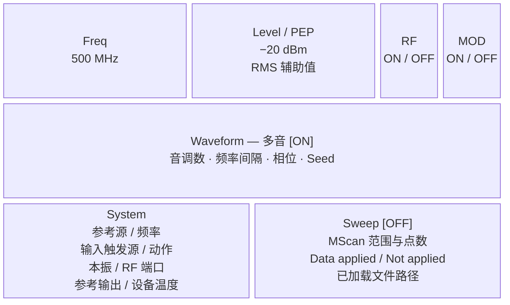
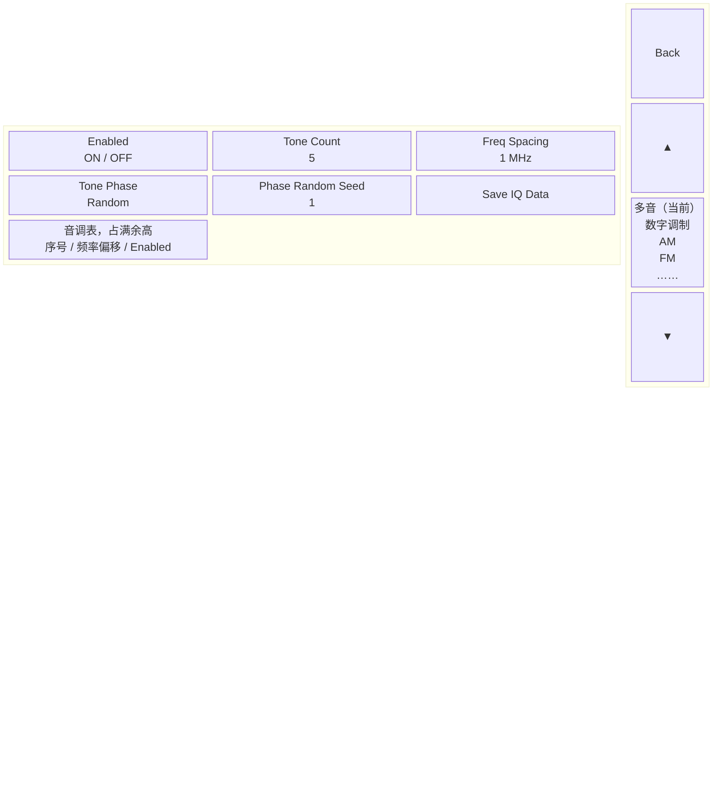
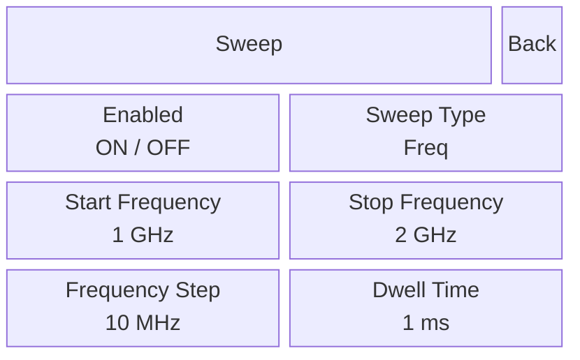
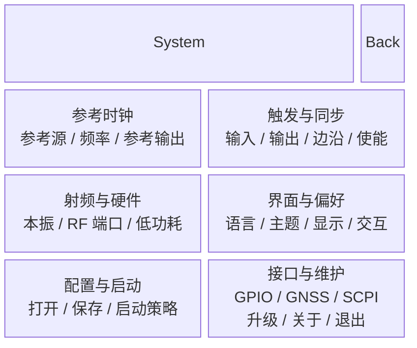
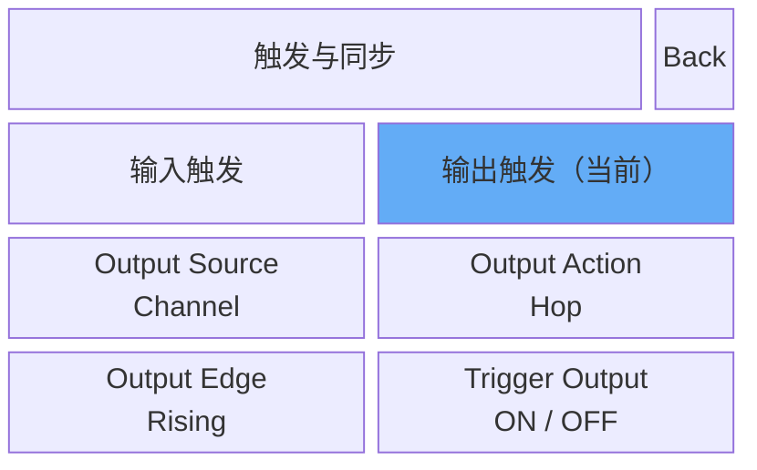

# SGStudio Instrument 模式：设计原则与交互说明

日期：2026-10-14  
适用：`--ui-mode=instrument`，5 寸横向 1024×600 触屏。  
依据：当前工作区代码与现行设计文档；参考 SMA100B User Manual v14。

## 1. 产品定位与启动方式

以--ui-mode=instrument 参数启动的 SGStudio 呈现为针对5寸屏幕适配的触屏信号源软件，即使不加任何启动参数，软件在识别到分辨率和平台信息符合特征的时候，也会自动使用这种布局启动，打包发布无需添加任何额外的工序和软件包。它复用现有设备能力、业务面板、参数绑定和执行链，所有功能初步测试均正常使用。

## 2. 设计原则与 SMA100B 借鉴

### 2.1 总览、配置、输入分层

SMA100B 的 Home 功能块同时承担参数总览和配置入口。SGStudio 采用这个组织原则，将首页划分为载波直接控制、Waveform 总览和 System/Sweep 入口。首页负责显示：**现在生效的是什么设置、哪些功能已使能、从哪里继续配置**。工作页用于完成具体任务；系统页按用户的设置目的分类。

| 手册依据（版本 14，印刷页码） | 手册事实 | SGStudio 的采用方式 |
| --- | --- | --- |
| 第 52 页图 3-9；第 53 页 3.4.2.1–3.4.2.2 | Home 顶部可直接编辑频率/电平；功能块概括参数并进入配置 | 小标题、大读数；首页 Freq/Level 可编辑；卡片展示摘要并导航 |
| 第 53–54 页 3.4.2.3、表 3-10 | 任务栏提供 Home 和已打开对话框入口 | 保留明确返回入口；按 5 寸屏设计省去左侧任务栏 |
| 第 55–56 页 3.4.3 | Home 将对话框最小化并回总览；Close/Esc 才关闭对话框 | 借鉴“回总览”和“关闭”的语义区分；SGStudio 使用自己的逐层 Back 协议 |
| 第 56–57 页 3.4.4 | 提供数值/字母数字键盘；数值用对应单位完成输入，无单位参数可 Enter；Esc 取消且不改设置 | 保留输入的完成/取消边界；单位与步长规则由 SGStudio 原键盘实现负责 |
| 第 204 页 8.5.1；第 218 页 8.6.1 | Sweep/List 在配置对话框内以 State 控制使能 | Home Sweep 只读显示状态，实际 Enabled 操作留在扫描页 |
| 第 220 页 8.6.2 | List Mode Data 标明当前加载文件 | MScan 首页摘要显示成功加载的文件路径 |

参考手册是 [SMA100B User Manual v14](C:/Users/jsl/Desktop/SignalDocs/SMA100B_UserManual_en_14.pdf)。三行 Home、Waveform 命名、右侧 Back、六类 System、标题 ON/OFF 和未 Apply 提示均为 SGStudio 定制。SMA 的 Home 最小化机制没有被原样移植。

## 3. Home 布局与摘要规则

### 3.1 三行布局

点 Freq/Level 编辑数值，点 RF/MOD 操作开关；点 Waveform、System、Sweep 整张卡片进入对应配置。Sweep 的 ON/OFF 只读，实际开关在扫描页。从 Home 点击 Waveform、Sweep、System 卡片，分别进入波形、扫描和系统页面。System 再点击分类进入设置页；

| 区域 | 当前尺寸与信息层级 | 用户操作 |
| --- | --- | --- |
| Freq / Level | 各约 360×128 px；标题 22 px，主值 38 px，辅助 RMS 22 px | 打开现有数值键盘 |
| RF / MOD | 各 128×128 px；状态值 28 px | 发出原 RF 操作或 Instrument MOD 请求 |
| Waveform | 1000×240 px；标题 30 px，参数 24 px；四列三行，最多 12 项 | 整卡进入对应 Waveform |
| System | 496×192 px；标题 30 px，八项摘要 20 px | 整卡进入 System 六类概览 |
| Sweep | 496×192 px；标题 30 px，普通参数 24 px，MScan 状态/文件 20 px | 整卡进入 Sweep；卡片内没有使能按钮 |

外边距为 12 px，行列间距为 8 px。宽度预算：`360 + 360 + 128 + 128 + 3×8 + 2×12 = 1024`；高度预算：`128 + 240 + 192 + 2×8 + 2×12 = 600`。这是代码与样式预算，触控舒适度、边框外框及字体裁剪仍需真机验证。

### 3.2 首页如何给出摘要

首页使用已有业务的显示值，避免再次解释单位、枚举、设备限制和功率含义。

| Home 项目 | 显示内容与来源 | 设计目的与边界 |
| --- | --- | --- |
| Waveform | 目标业务名称、ON/OFF、原 Panel 按关联属性组织的名称与显示值，包含多音生效音数和 Playback Auto Scale 状态 | 每行最多四项、最多三行；组内少于四项保留空位，完整摘要见整卡 tooltip |
| 频率扫描 FScan | 起止频率、Frequency Step、Dwell Time | 给出范围、粒度与节奏；标题状态来自原 Enabled |
| 功率扫描 LScan | 起止电平、Level Step、Dwell Time | 保持与频率扫描相同的阅读结构 |
| 列表扫描 MScan | 有效时显示 1-based 起止索引和选中点数；无效时显示草稿点数及原因；另给数据 Apply 状态与加载路径 | 看出数据是否可用、是否成功提交；设备执行结果不混入数据 Apply 状态 |
| System | 四行两列八项当前设置/读数，见下一表 | 首页保留影响信号解释的基准、触发、RF 硬件和温度 |

采用与 System 摘要一致的 QLabel + QGridLayout，四列等宽、三行，列间只保留 2 px 间隙（原 8 px），行间为 0，内部布局无额外边距；各列剩余宽度均用于显示。每格显示一项“名称: 值”，保持 24 px、单行不自动折行；原文中的换行/连续空白在格内压成单行空格，超出格宽时中间省略，以保留名称开头和数值/单位末尾，完整原文保留在整卡 tooltip。

每行是一组关联属性，不要求凑满四项，下一组从下一行开始。行末空格及隐藏/无值字段的位置保持为空，不把后续参数前移；所有空格都会清空，切换类型后不残留旧值。尺寸/字体变化重新计算省略。当前类型最多使用 12 个位置；超出时只展示前 12 个位置，tooltip 仍包含全部非空字段，并去掉仅用于布局的空项。

### 3.2.1 各类 Baseband / Waveform 的实际摘要字段

下表按当前纳入 CMake 的 UI 和业务注册核对，字段名保留原控件标题便于对应代码，运行时沿用原翻译、单位和枚举显示值。每个表格单元内最多四个字段，依次占据该行四列；未列出的列为空，不从下一行补齐。实际出现的类型受插件构建、设备能力和原许可规则约束，控件字段还须满足上面的可见/非空条件。各 Panel 的 `summaryParameters()` 提供完整分组顺序；共同的 `summaryParametersForButtons()` 只格式化原控件标题和值，`nullptr` 表示留空，隐藏控件也返回空位置。多音生效音数与 Playback Auto Scale 由原 Panel 在对应位置填入，变化沿用 `summaryChanged`，不新增工作页控件或配置副本。未覆写该查询的 Panel 默认沿用原可见字段采集。

| Waveform 类型 / 原 Panel | 第 1 行（最多四项） | 第 2 行（最多四项） | 第 3 行（最多四项） | 条件与说明 |
| --- | --- | --- | --- | --- |
| AM / AmPanel | Shape；Rate；Depth(%) | — | — | 三项；波形形状、速率与深度放在一起 |
| FM / FmPanel | Shape；Rate；Deviation | — | — | 三项；波形形状、速率与频偏放在一起 |
| PM / PmPanel | Shape；Rate；Phase Deviation(deg)；Init Phase(deg) | — | — | 四项；形状、速率与相位参数同组，角度含义不变 |
| Pulse / PulsePanel | Period；Width；Duty Cycle(%) | — | — | 三项；周期、宽度及计算占空比同组 |
| Multitone / MultitonePanel | Tone Count；Enabled Tones（生效音数，如 98/100）；Freq Spacing | Tone Phase；Phase Random Seed | — | 第一行是音数与频率分布，第二行是相位。Random 五项，其他相位四项，Seed 位置留空，相位仍在第二行。Notch Width 当前隐藏，逐音明细不进入摘要 |
| Digital Ramp / RampPanel | Span；Sweep Time；Period | — | — |  |
| AWGN / AwgnPanel | Bandwidth；Length | — | — | 两项；Seed 当前隐藏，不补到摘要 |
| Playback / ArbPanel | File Name；Sample Rate；Samples In File | Samples To Use；Sample Offset；Signal Length | Period_Arb；Period Length；Auto Scale（ON/OFF）；I/Q Scale(%) | 十项；分别为文件信息、使用区间、周期与缩放。前两行第四列留空，不新增文件时长；Signal Length 是使用点数对应的时长。未加载文件沿用原 N/A/0，IQS-WAV 强制 Auto Scale 时显示 ON |
| Streaming / StreamingPanel | Total Files；Total Samples；Total Duration | Sample Rate；Playback Pos；I/Q Scale(%) | — | 六项；文件总量与播放参数分组，位置沿用实时显示；两行第四列留空，文件路径不展开 |
| Digital Modulation / DigitalPanel | Modulation Type；Symbol Rate；Oversample；FSK Deviation | Filter Type；Filter Alpha；Filter Length (symbols) | PN；Sequence Seed | 九项；按调制/速率、滤波、数据序列分组。FSK Deviation/Filter Alpha 的可编辑性沿用原规则，只读不等于隐藏 |
| DSSS / DsssPanel | Modulation Type；Symbol Rate；Oversample | Filter Type；Filter Alpha；Filter Length (symbols) | Code；Sequence Seed | 八项；按调制/速率、滤波、扩频序列分组；首两行第四列留空 |
| OFDM / OfdmPanel | Modulation Type；FFT Size；Carrier Spacing；Sample Rate | Symbol Count；Guard Interval (%)；Guard Interval Length | Guard Band Carriers (Left)；Guard Band Carriers (Right)；Window Length (%)；Window Length | 十一项；基础载波、符号时序、频谱边界/窗口分组，第二行第四列留空。只读计算结果复用原显示；Null DC/Windowed 开关不进入参数格 |
| Quick Waveform / QuickWaveformPanel | Sample Rate；I/Q Scale(%) | Samples To Use；Sample Offset | Period_Arb；Period Length / Duration | 六项；采样/缩放、使用区间、周期分组，每行后两列留空。周期/文件总时长组合复用原显示，不新增文件时长；文件名位于文件表，Auto Scale 暂不进入摘要 |

所有类型的业务名称和 ON/OFF 已在 Waveform 标题展示，不占上述 12 个参数格。Enabled/Auto Scale/Null DC/Windowed 等 SwitchButton、保存/加载/预览等动作按钮以及表格明细不由控件格式化规则展开；Playback 的 Auto Scale 和多音生效音数由对应 Panel 的完整摘要查询提供。CW/Mute 属于执行链状态，Sweep 有独立卡片，GNSS 是 System 功能入口，都不是本表的独立 Waveform 类型。

多音生效音数直接统计 `MultitonePanel::m_candidateTones` 的 `enabled` 状态：100 音全开为 `100/100`，关闭两音为 `98/100`，全关为 `0/100`。单音/批量勾选、Tone Count 或配置恢复同步频表后立即更新，不等待异步生成；不采用上一波形生成的 `effectiveToneCount`，也不以 RF/MOD 开关判定音是否被勾选。MOD OFF 时仍按既有目标规则显示用户选定多音的频表配置；该字段不是设备已输出确认。沿用本轮暂缓 Excel 翻译的约定，新增 `Enabled Tones` 文案暂显示英文。

Playback 的 Auto Scale 读取原 `btnAutoScale` 标题与当前状态，沿用 ON/OFF 显示；用户切换、`Arb_AutoScale` 属性回写和 `setAutoScaleLocked()` 文件模式同步后通知摘要刷新。IQS-WAV 强制开启并锁定开关时显示 ON，不把保存的普通 WAV 偏好误当作实际状态。Auto Scale ON 时 I/Q Scale(%) 仍沿用原只读显示，该保存值不代表正在执行手动缩放。此项不改变缩放算法、原参数可编辑性或 main 布局，Quick Waveform 本轮仍按原字段表展示；不修改 Excel。

Home 没有单独的 CW 卡片。MOD OFF 时 Waveform 仍展示当前可编辑波形及 OFF；RF ON、MOD OFF 时由既有执行链选择 CW 或扫描 CW。不能把卡片中的波形名称当作当前已调制输出的证明。

### 3.3 System 卡片：四行两列

| 行 | 左列 | 右列 | 为什么放在首页 |
| --- | --- | --- | --- |
| 1 | 参考时钟源 | 有效参考频率 | 明确频率基准 |
| 2 | 输入触发源 | 输入触发动作 | 明确由谁触发、触发执行什么 |
| 3 | 本振模式 | RF 输出端口 | 明确射频硬件配置 |
| 4 | 参考时钟输出 ON/OFF | 射频设备温度 | 明确同步输出及设备监视读数 |

参考源、触发、本振和 RF 端口来自原 property 及枚举显示项；有效参考频率和参考输出来自 CommonDeviceProfile；温度来自 DeviceRuntimeBridge 的当前射频设备状态，**不是树莓派 CPU 温度**。

无设备或温度无效时对应值显示 `—`；长值按单元格宽度省略，完整值可从 tooltip 查看。摘要不独立查询硬件，也不保留第二份温度或设置缓存。这里的触发只是源/动作摘要，首页没有新增手动 Trigger 按钮。

## 4. Waveform 工作页与 MOD 目标

### 4.1 看见的波形与控制目标一致

| 当前状态 | Home 摘要、点击进入与外部 MOD 的共同目标 |
| --- | --- |
| MOD ON，已启用 A，正在浏览/编辑 B，返回 Home | 将当前选择恢复为 A，然后统一取当前 A |
| 随后在 Home 关闭 MOD | 仍为当前 A，参数保留，标题改为 OFF |
| MOD OFF，当前浏览/编辑 B | 当前页面的 B（currentBusiness） |
| B 所需文件尚未加载、原使能入口不可用 | 展示 B 的 OFF 状态，保留原可用性限制 |
| 使能需要确认，用户取消 | 按原面板回写保留未使能状态 |

台表首页只呈现一个当前 Waveform。MOD ON 时真正返回 Home，会将工作页和右侧列表当前项对齐到已使能 Waveform；MOD OFF 时保留用户当前选择。启动配置恢复后进入 Home 也遵循这一规则。概要、MOD 可用性和操作都直接读取同一个 currentBusiness，点击概要进入已有当前工作页；不再按 MOD 状态分别解析两个目标，也不额外记忆上次使能对象。

### 4.2 外部 MOD 是显式用户命令

Home MOD 不先自行翻转显示状态，而是经 MainWindow 调用目标 Panel 的原用户使能入口，保留原文件前提、确认、互斥选择和完成回写。成功或取消后，才根据实际面板选择状态收敛公共 MOD。

普通基带不要求用户先进入 Panel 手动使能；Playback、QuickWaveform、Streaming 仍须满足原文件入口的可用性。外部 MOD 的显式请求不依赖 Auto Mod 偏好；面板内部用户使能/关闭与 MOD 的自动联动继续遵循原 Auto Mod 规则。

若目标原面板已处于请求状态，不重复触发其使能控件，但仍完成公共状态与可用性的收敛。面板使能回写不等同于 RF 硬件执行完成。

### 4.3 工作页布局

以多音 Random 模式为例，左侧独立重排为三列、固定两行参数，下方是占满余高的原音调表；右侧是固定的 Back 与类型列表：

点参数编辑，点类型切换当前面板，▲/▼滚动类型列表；点 Back 回 Home。右侧列表高亮只表示正在编辑的类型，切换类型本身不使能波形。

左侧约 860 px 复用现有业务控件和绑定，允许纵向滚动；多音在 Instrument 中单独创建三列布局，不沿用桌面 Panel 的两列排法。右侧约 132 px 放固定 Back 和单列类型列表。列表上下箭头只滚动类型列表；高亮表示当前浏览类型，原设备和许可限制继续适用。

选择类型切换现有业务；动态字段继续由原绑定负责。多音 Random 显示 Seed，Fixed/Parabolic 隐藏 Seed 后，Save IQ 从右列前移至中列，只占一列并与其它按钮同宽，最后一列留空；两种布局都保持两行参数，表格在第三行跨三列，保存操作不再单独占底部一行。Instrument 频表表头为 22 px、逐音 checkbox 为 30 px，原 45 px 行高与点击/多选逻辑保持。普通 main 继续采用原两列动态布局、18 px 表头、24 px checkbox。

上述多音调整仅改布局和呈现，复用原参数控件、生成与保存逻辑；没有新增生成波形、AutoScale 或其它业务操作。MOD ON 返回 Home 前恢复当前页到已使能 Waveform；此操作仅改变浏览页，不自动使能正在浏览的其他类型。Home 摘要分组与 main 浏览/使能语义保持现状。本轮仅静态核对，未编译/运行；见 [实施 TaskLog](../TaskLog/2026-10-15_instrument-multitone-two-row-layout.md)。

数字调制页的“默认截断下发”沿用原 QCheckBox；Instrument 模式文字为 28 px、控件高度 56 px、indicator 为 40×40 px。原 Controls SVG 四周有留白，可见外框约占资源尺寸的 2/3，因此指示区 40 px 对应约 27 px 可见方框。继续使用原 `border-image` 拉伸资源，深浅主题及选中/未选中均沿用已有图标；规则写在此控件原局部 QSS 内，并限定 Instrument 的 mainContent 祖先。普通 main 保持原 40 px 控件高度、24 px indicator 及继承字体。仅调整呈现，截断偏好与确认/下发逻辑不变；[本轮实施记录](../TaskLog/2026-10-15_instrument-digital-trim-checkbox-size.md)仅静态核对，未编译/运行。

Streaming 文件列表与参数共用工作页外层滚动条：Instrument 下 FileList 的内部纵横滚动条均关闭，使用 `AdjustToContents` 和纵向 `QSizePolicy::Minimum`，按整张表的表头及文件行给出不可压缩的内容高度，横向策略保持原样。加载、配置恢复、增删、清空和重排由 Qt 现有模型/布局更新尺寸提示，不设固定列表高度或另存行数；列表内容随 Panel 一起滚动，右侧 Back/类型列表仍独立。只在归属 Instrument 窗口后的 showEvent 配置，普通 main 继续使用原表内滚动；文件选择、拖动排序及 Streaming 执行规则不改。见 [单一滚动实施记录](../TaskLog/2026-10-15_streaming-single-scroll.md)，本轮仅静态核对，未运行验收。

## 5. Sweep：导航、使能与提交阶段

### 5.1 Home 看状态，Sweep 页执行操作

扫描页直接承载原 StepSweepPanel：Freq 对应 FScan，Power 对应 LScan，List 对应 MScan。Enabled 和原参数/Apply 入口都保留在该页。

Home 的 `Sweep [ON/OFF]` 是只读标题。点击整卡进入配置，不写扫描开关、不自动 Apply。进入或离开扫描页也不关闭当前扫描。10 月 12 日曾采用卡片内快速开关，10 月 13 日已移除；本文使用最新规则。

以 Freq 扫描为例：

点 Enabled 开关扫描，点 Sweep Type 选择 Freq/Power/List，点参数编辑；点 Back 回 Home。选择 List 时显示原点表编辑、文件和 Apply 操作。

### 5.2 MScan 数据 Apply 与设备执行分开

| 阶段 | 表达的事实 | Home 应避免的误解 |
| --- | --- | --- |
| Draft | 用户当前编辑的点表与范围 | 编辑有效不代表已提交 |
| Submitted | 原 Apply/使能入口校验并提交的快照 | 提交不代表当前设备已完成配置 |
| Applied | 原执行链保存的实际设备完成结果 | 不作为 Home 的数据 Apply 状态来源 |

Home 只读取 Draft/Submitted，按提交有效性和版本是否一致显示 `Data applied` 或未 Apply。数据成功 Apply 后，RF/Sweep 为 ON 或 OFF 都不改变这一事实；用户再次编辑才需要重新 Apply。原 ON 入口成功提交数据也可清除未提交提示。

设备执行结果继续留在原运行链的 Applied，不写回用户编辑表，不把设备浮点回读差异变成一次新编辑。Home 只作无副作用校验，不自动 Apply 或发射命令。

### 5.3 MScan 状态摘要矩阵

| 当前条件 | Home 主要提示 | 用户下一步 |
| --- | --- | --- |
| 空表、列不一致、非法范围或超出点数/设备范围 | `Cannot enable` 加简短原因 | 进入扫描页修正并 Apply |
| 当前设备能力不可用 | `Cannot enable: Device unavailable`；数据已提交仍保留 `Data applied` | 先恢复设备可用性，不把设备问题当作新编辑 |
| 合法 Draft 尚未提交，或 Draft/Submitted 版本不同 | `Not applied; press Apply` | 在原扫描页提交 |
| 扫描 ON，且仍有当前设备的有效旧提交，新 Draft 未提交或无效 | 同时提示未 Apply 与 `Using previous data` | 明确编辑不会替换此前提交 |
| 当前 Draft 成功提交，RF/Sweep 为 ON 或 OFF | `Data applied` | 仅表示数据 Apply 成功，扫描开关在原页面操作 |

关键错误和未提交提示优先于路径，状态最多三行，另留一行加载来源；较长说明保留在 tooltip。仅匹配当前设备及能力版本的旧提交才能被描述为“仍使用此前数据”。

首页已移除旧的 `Device not confirmed` 文案与 Applied 订阅。数据 Apply 状态不再依赖 RF 或设备执行；真实执行确认和错误继续由原 Tx 链路处理，见 [数据 Apply 与设备确认拆分记录](../TaskLog/2026-10-13_separate-mscan-data-apply-from-device-confirm.md)。

### 5.4 文件来源应可信

| 操作 | Home 文件路径 |
| --- | --- |
| 成功加载含有效行的完整点表文件 | 显示其绝对路径 |
| 对已加载点表普通编辑或 Apply | 保留加载来源；提交状态另行说明 |
| 导出到另一个路径 | 保留加载来源，导出目的地不会覆盖它 |
| 取消选择、加载失败或无有效行 | 不替换原成功加载来源 |
| 清空、删除所有行、恢复配置或外部 Draft 替换 | 清除加载来源 |
| 恢复此前会话 | 不额外恢复路径；现有持久化不包含此字段 |

原 ListModePanel 持有唯一来源路径，经 StepSweepPanel 的只读接口提供给 Home。长路径中间省略，tooltip 保留完整路径。路径表示数据来源；普通编辑后，它不保证当前 Draft 与磁盘文件逐字一致。

## 6. System：按设置目的分类

### 6.1 六类入口页面

System 使用两列三行分类卡片。前三类回答设备怎样产生和同步信号；后三类回答用户怎样操作、恢复配置以及连接和维护系统。

点整张分类卡片进入设置，点 Back 回 Home。分类页的 Back 先回到这六类入口。分类是对现有业务的组织，没有新增硬件参数；“界面与偏好”用于操作界面，“接口与维护”用于功能接口和维护。

| 分类 | 回答的用户问题 | 概览卡片的当前表达 |
| --- | --- | --- |
| 参考时钟 | 频率基准从哪里来，是否向外提供参考？ | 当前参考源、有效频率、参考输出 ON/OFF |
| 触发与同步 | 谁触发、执行什么、怎样向外同步？ | 当前输入/输出源、动作、边沿和输出使能 |
| 射频与硬件 | 射频输出走哪个端口，硬件模式如何？ | 当前本振模式、RF 端口、低功耗 |
| 界面与偏好 | 显示和触摸交互怎样适应用户？ | 当前实现为“语言、主题、显示与交互偏好”等功能范围摘要 |
| 配置与启动 | 怎样保存/恢复设置，下次启动用哪种状态？ | 当前实现为打开/保存、启动恢复策略的功能范围摘要 |
| 接口与维护 | 怎样进入接口、升级、信息与退出操作？ | 当前实现为可访问功能范围摘要；入口遵循原动作可见性/可用性 |

后三类目前没有扩展为全部实时值摘要；不要把分类概览的功能说明当作当前已选的语言、启动策略或接口连接状态。Home 的 System 八项当前值与本页六类概览承担不同的信息密度。

### 6.2 分类页字段与 Tab

以“触发与同步”的输出 Tab 为例：

点 Tab 在输入/输出设置间切换，点枚举选择参数，点 Trigger Output 开关触发输出；点 Back 回 System 六类入口。Tab 切换不会改变返回层级。

| 分类 / 页签 | 当前内容 | 条件与生效边界 |
| --- | --- | --- |
| 参考时钟（单页） | Ref Source、Ref Frequency、RefOut | Internal 频率只读，External 按原属性规则可编辑；输出用横向开关 |
| 触发与同步 / 触发输入 | 输入源、输入动作、输入边沿 | 原 Trigger 属性与设备能力 |
| 触发与同步 / 触发输出 | 输出源、输出动作、输出边沿、输出使能 | 输出使能用横向开关 |
| 射频与硬件（单页） | 本振模式、RF 输出端口、低功耗 | 原控件能力决定可用性；低功耗用横向开关 |
| 射频与硬件 / 原诊断字段 | 设备风扇模式、自动风扇温度阈值 | 保留原 debug-only 条件，正式产品不补新字段占位 |
| 界面与偏好 / 显示 | Language、Theme；按硬件条件提供亮度入口、Auto Bright | Language/Theme 适配原菜单动作及原重启确认 |
| 界面与偏好 / 交互 | Auto Mod、Screen Lock；按硬件条件提供震动、机箱风扇 | 复用原偏好 owner；机箱风扇与设备诊断风扇含义不同 |
| 配置与启动（单页） | 打开配置、保存配置、Power On State；User Preset 时显示预设文件 | 启动选项保持 Default / Last State / User Preset |
| 接口与维护（单页） | GPIO、GNSS、SCPI、软件/固件升级、关于、退出等原动作 | 由注册动作、插件、平台和硬件条件决定实际出现及可用性 |

布尔值用横向标签与 SwitchButton，枚举/数值用大双行参数按钮，动作采用明确按钮。没有硬件能力时按原条件隐藏或禁用，不以猜测值补齐版面。

断开设备时，前三类设备分类的摘要整块显示 `—`；Low Power 不支持时该项显示 `—`。分类摘要读取已有控件与 Profile 镜像，不新增查询或轮询。

### 6.3 分组与生效设计

触发输入和输出放在同一分类的两个 Tab，因为用户常需要对照配置同步关系；显示和交互分别成 Tab，因为它们服务同一使用环境。参考时钟、射频硬件保留单页。配置与启动将文件动作、启动策略和预设来源同时呈现，用户不需切 Tab 才能理解它们的关系。

选中 Tab 使用既有主题蓝色填充高亮，只表达当前页签。分类和 Tab 只是页面呈现，不增加 System 级 Apply/Cancel 事务，各项仍按原功能生效。

| System 操作 | 当前规则 |
| --- | --- |
| 修改设备设置或偏好 | 走原 property/快捷接口/设置 owner |
| 改语言或主题 | 走原动作与重启确认；拒绝时恢复原选中项 |
| 修改 Power On State | 改变下次启动策略，不即时加载配置 |
| 选择 User Preset 后取消文件选择 | 原控制器恢复之前 QAction 选中状态，不留下未完成的新策略 |
| 加载配置 | 复用原 persistence/controller，并保持 System 分类上下文 |
| 打开 GPIO/GNSS/SCPI/升级/关于等 | 打开原功能窗口；关闭后回所属分类 |
| Back 或 Tab 切换 | 不重置配置，不触发 RF/MOD/扫描使能 |

Language、Theme、Power On State 以持久的 EnumTextButton 适配原 QActionGroup：菜单选择是已选值的来源，Popup 打开高亮只是交互反馈。控件在主窗首次显示前装配，不在 stacked 切页的 showEvent 中首次构造 Popup，以避开本次已复现的动态构造禁绘问题。

## 7. 输入、触控与主题

输入方式沿用参数类型，而不是所有参数都打开同一种对话框。

| 输入类型 | Instrument 交互 | 需要保留的行为 |
| --- | --- | --- |
| 数值 | 原数字软键盘，定位于主窗口右侧、垂直居中 | 单位、范围、步长、提交/取消与原校验 |
| 枚举 | 原 EnumTextButton 的 Popup 列表 | 原可用选项与已选值；打开高亮不代替真实选值 |
| 布尔 | 横向标签和开关 | 原业务使能或偏好语义 |
| 文件 | 原文件选择和加载/保存流程 | 取消不改变已生效配置；加载来源与导出目标分开 |
| 文本 | 底部托管键盘与字段回显，提供字母/符号页 | 焦点、光标、实际输入字符与目标字段同步 |
| 确认 | 原确认窗口 | 明确接受或取消，Home 导航不跳过它 |

Instrument 数值键盘自 2026-10-15 改为 440×600 px，全高靠右初始显示；顶部仅保留 20 px 拖动条。第一行复用原主值输入框，保持原输入高度与 24 px 字号；Home Center/Level 等实际带 Step 的入口将原 Step 控件放在同一行右侧，主值/Step 约 2:1。没有 Step 的入口主值占满整行，不保留标题空行。Step 数字 24 px、标识 18 px，焦点输入框有局部蓝色边框，沿用原焦点与快捷单位切换，功率主值与 dB 步长语义保持不变。

五行主键区与四列均分剩余空间，键帽内容最小高度 90 px、字号 26 px、图标 30 px。窄拖动条复用原鼠标/触摸拖动及边界钳位，标准 600 px 高宿主中主要左右移动。Wayland 容纳检查仅对 Instrument 允许零额外边距，保持键盘位于原 MainWindow overlay；普通 main、helper 和贴底文本键盘保留原尺寸、标题与布局。参数名称仍可从窗口 title/拖动条 tooltip 获取；本轮仅静态核对，未运行或真机验收。实现边界见 [软键盘架构](soft_keyboard_architecture.md#25-editablewidget--ieditabletitlewidget标题栏步长编辑器)。

文本键盘的 Done 关闭键盘，保存仍由原文件对话框的 Save 动作执行；键盘完成与文件保存是两个阶段。符号 `&` 的键帽转义只用于显示，实际输入仍是单个 `&`。

工作页主要参数控件约 96 px 高、28 px 字号；System Tab 约 52 px 高、24 px 字号；Back 构造尺寸为 132×48 px，并共用 48 px 高度样式。表格、数字键帽、文本键帽有各自尺度，不应被普通参数按钮规则覆盖。

Light/Dark 使用现有主题，再追加限定 Instrument 页面和对象的样式。相同控件在两主题中保持尺寸规则一致，Tab 高亮用各自主题色；数值小数点、负号、单位、长枚举和长路径都需单独检查可读性。空间不足时保留滚动可达性，不靠隐藏必要参数或缩小到难以触摸来补偿。

## 8. 状态来源与实现边界

Instrument 的实现原则是“呈现适配复用业务 owner”：UI 负责安排、导航和展示，参数校验、配置提交、设备执行与完成发布留在原组件。

MainWindow 的外层页面栈持有 Home、Waveform、Sweep、System；System 内部内容栈持有六类概览和分类页。原 DeviceSettingPanel 继续持有唯一设备参数控件；共享 PreferencePanel 在桌面由 PreferenceDialog 包装，在 Instrument 由 System 页面承载。Home 借用原面板和服务读取摘要。

摘要通过原参数/选择/使能/服务变更通知合并刷新，并在返回 Home 时立即同步。MainWindow 的共用 Home 进入边界负责当前选择对齐，原输入/功能弹窗/System 分层 Back 在对齐之前处理。Home 只在浏览对象变化时重绑 Panel，Mod 和使能业务变化只刷新状态。长值和路径在尺寸、字体变化后重新计算省略。程序化状态刷新不伪装成用户编辑，页面切换也不伪装成使能请求。

本轮设计不增加新的 SCPI 语义、SDK 硬件查询或持久化格式。新英文标题/摘要键的 Excel 翻译仍暂缓，中文运行时部分文案可能显示英文。

## 9. 当前完成状态与验收重点

当前工作区已具备三行 Home、右侧固定 Back、单列 Waveform 类型列表、独立 Sweep 工作页、System 六类页面和所述摘要规则。近期改动多数仅完成静态核对；此前某次 Debug 构建或 Popup 隔离复现不能替代整个最新版本的运行验收。本说明编写过程不构建或启动 SGStudio。

| 验收场景 | 应满足的体验 |
| --- | --- |
| 树莓派 1024×600 启动、显式 main/instrument | 参数优先级正确，首页无任务栏偏移或内容裁切 |
| Home 三行、深浅主题、长数值和译文 | 主要数字清楚，负号/小数点/单位完整，摘要和路径不挤出关键状态 |
| MOD ON 的 A 与正在编辑的 B | Back 后当前选择恢复为 A；Home MOD OFF/ON 后仍显示并控制 A |
| 文件波形未加载、确认取消与成功回写 | MOD 可用性和状态沿用原协议，不提前显示成功 |
| MScan 空表、非法数据、编辑未 Apply、成功 Apply 后切换 RF | 数据提交状态准确，设备执行不改变草稿版本；旧扫描数据仍按当前设备/能力判断 |
| 加载、编辑、导出、失败加载、清空、恢复 | 文件来源符合路径矩阵 |
| System 两类 Tab、三种菜单适配枚举、硬件条件项 | 当前值、选项、Popup、蓝色高亮及条件可见性正确 |
| 配置加载、User Preset 取消、功能窗口返回 | 原配置规则有效，分类上下文和分层返回一致 |
| 键盘/枚举/确认打开时操作 Home、Wayland 托管窗口 | 不跳过未完成输入，焦点和一层关闭协议正确 |
| 参数区和长表格滚动 | 所有原必要控件可达，Back 固定不随内容移动 |

后续改动应持续检查三个边界：**显示对象与操作对象是否一致，业务阶段是否被准确表达，交互是否复用了同一份权威状态**。

## 10. 依据与进一步阅读
### 当前代码入口

以下均在当前 CMake 工程纳入范围内。路径相对 SGStudio 源码根 `D:\development\vsg2.0`：

| 文件 | 本文对应职责 |
| --- | --- |
| `src/plugins/core/coreplugin.cpp` | startupUiMode：显式参数与树莓派自动选择 |
| `src/plugins/core/mainwindow.cpp` | 外层页面栈、工作页、Back、MOD 请求和可用性 |
| `src/plugins/core/instrumenthomewidget.cpp/.h` | Home 摘要与统一 Waveform 目标，System 分类内容 |
| `src/plugins/core/commonpanel.cpp` | 首页直接控制、频率/电平与 RF/MOD |
| `src/plugins/core/devicesettingdialog.cpp` | 原设备参数控件及 Instrument 分类布局 |
| `src/plugins/core/preferencedialog.cpp` | 共享 PreferencePanel 与显示/交互布局 |
| `src/plugins/core/mainwindowsettingscontroller.cpp` | Instrument 样式、菜单动作和设置恢复 |
| `src/plugins/core/stepsweeppanel.cpp`、`listmodepanel.cpp`、`mscantableservice.cpp` | 扫描类型、点表阶段、来源路径和提交校验 |
| `src/libs/controls/touchnumkeyboard.cpp`、`Keyboard.cpp` | 数值/文本键盘与输入呈现 |
| `src/plugins/core/CMakeLists.txt`、`src/libs/controls/CMakeLists.txt` | 上述实现的工程纳入范围 |

