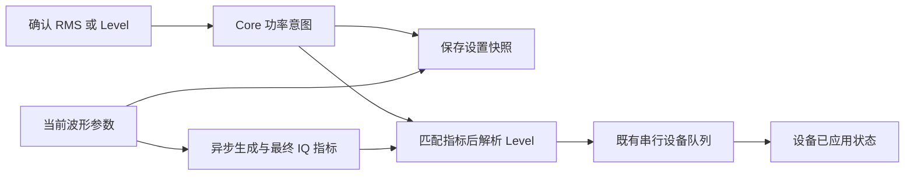

# SGS Level / RMS 异步交互与配置保存设计

日期：2026-10-26。状态：当前实施方案已完成源码修改与静态检查，尚未编译/运行验收。2026-10-23 基线见 [原 RMS 方案](rms_pep_simd_cross_platform_design.md)。实施记录见 [本轮 TaskLog](../TaskLog/2026-10-26_implement-rms-level-async-persistence.md)。

2026-11-03 最终更新：功率保持量由业务插件的 `BasebandProviderCapabilities::powerHoldMode` 声明，默认 Rms，Pulse 声明 Level。用户已将 Pulse RMS 改为只读，替代此前的一次性 RMS 输入方案。Pulse 保持 Level，RMS 随最终 IQ 更新，主窗/Minibar 禁止编辑、SCPI SET 拒绝、QUERY 可读平均功率；Streaming 仍显示 -- 且不能输入。下文“Level 成功后建立 RMS / 持续保持 RMS / RMS 输入”的合同适用于声明 Rms 的业务。RMS 标签/布局、未知派生 -- 和 G6～G10 不变，G13 覆盖 Pulse 只读。保存格式仍为 5；`level` 对 Pulse 表示持续 Level。选择 Pulse 时包括配置恢复事务均保持 API Level，旧文件中的 rms 目标不再反推 Pulse 电平。实现与静态审查见 [只读修改 TaskLog](../TaskLog/2026-11-03_pulse-rms-readonly.md)，尚未编译/运行验收。

当前合同沿用“成功应用后建立 RMS”，已补持久化、旧配置/Reset 恢复、对外 RMS SCPI、第 12 节 RF OFF 联动和 Minibar 同 Level 失败重提。随后用户确认对称显示：明确输入保留，当前参考未知时另一派生字段显示 --；已知参考的数值预览不提前改变保存参考。页面布局及下载阶段拆分没有纳入实现。本文已统一早期“指标就绪立即建立 RMS”与当前成功边界之间的冲突；第 12 节为执行合同，第 5.2 节为显示合同，第 13 节为当前人工验收。实施依据见 [实施前复核](../TaskLog/2026-10-26_rms-next-implementation-review.md)，本次审核见 [对称显示 TaskLog](../TaskLog/2026-10-26_rms-level-symmetric-display-audit.md)。

当前保存格式为 `formatVersion=5`，顶层 `power={reference,valueDbm}`，reference 为 `startup/rms/level`；保留旧 `common.Level`。读取旧文件或空默认配置进入 Startup，清除加载前的 RMS/显示历史。新格式的版本、reference 和有限数值在状态变更前校验。Load、Last State、设备 profile 与 Preset/*RST 共用 Core 功率恢复/reset。

公开 SCPI 为 `[SENSe:]POWer:RMS <数值>[dBm]` 和 `[SENSe:]POWer:RMS?`，裸数按 dBm；只接受一个有限数值。SET 复用 Core 的 rmsEditable：Pulse、L/MScan 和启用 Streaming 时拒绝。QUERY 复用当前数值有效性：Pulse 可读派生平均功率；L/MScan、启用 Streaming、未知统计或 Rms 业务尚未成功的 Level 输入，返回 `9.91E37` 并记录 `-221 SettingsConflict`。在 Rms 输入下返回已接受目标，即使尚未应用也可返回；Startup 的 Level 镜像只用于 Rms 业务。查询不可用不清除返回原业务时保留的功率意图，也不证明输出功率或硬件完成。原 Level SCPI 合同保留。[此前一致性审查](../TaskLog/2026-11-03_rms-policy-consistency-review.md)中的可编辑/可查询绑定已由只读修改拆开，未新增状态。

## 1. 推荐结论

Level 和 RMS 可以有两个编辑入口，但同一 RF 通道只有一个有效功率意图。保存的是已经确认的设置意图；波形指标决定数值换算和预览；匹配设备成功确认执行，并按当前合同将一次性 Level 意图规范为持续保持的 RMS。设置、派生显示与设备回写不能共用一个会被异步回写覆盖的目标数值。

SGS 默认保持 RF RMS。输入 Level 是一次换算入口：有匹配指标可预览 RMS，没有指标则保留明确 Level 并显示 RMS=--；只有匹配的有效执行成功后才建立持续保持的 RMS。确认 RMS 则立即接受并显示目标，未知派生 Level 显示 --，内部保留原 API Level，等待匹配参考解析。

从日常信号源使用看，输出端平均功率应当易于在 RF/公共栏直接设置。Baseband 负责波形、相对电平、数字缩放及波形功率统计。如果 Baseband 页面保留一个 dBm 的 RMS 输入，它应明确叫作 RF RMS，并且只是同一通道功率设置的快捷入口，不是该调制插件私有的第二个绝对功率目标。

## 2. 成熟产品的依据与借鉴边界

| 官方资料 | 可确认的事实 | 对 SGS 的启示 |
| --- | --- | --- |
| [R&S SMW200A 应用笔记，第 7 页](https://scdn.rohde-schwarz.com/ur/pws/dl_downloads/dl_application/application_notes/1gp143/1gp143_e_ExtAmp.pdf#page=7) | 文中的 RF Level 对应平均功率；PEP 比它高一个 crest factor | 面向使用者的 RF 电平可以代表平均功率，不能把 SMW 的 Level 直接等同于 SGS 当前 API Level |
| [R&S 数字 I/Q 输出入口选择](https://rohde-schwarz.github.io/RsSmw_PythonDocumentation/Source_Iq_Output_Digital_Bbmm_Power_Via.html)、[RMS 电平入口](https://rohde-schwarz.github.io/RsSmw_PythonDocumentation/Source_Iq_Output_Digital_Bbmm_Power_Level.html) | I/Q 输出有 PEP/Level 输入选择；这是 I/Q 输出路径的电平控制 | 同一信号的多种表达应有明确参考；不要把数字 I/Q 输出设置与 RF 端口 dBm 混为一谈 |
| [Keysight PSG / Signal Studio 功率控制](https://helpfiles.keysight.com/csg/n7615/Content/Main/Power_Control_for_E8267D_PSG_Signal_Generators.htm) | 特定突发信号场景使用波形头中的 RMS 电压作 power search 参考，选择新波形会重新进行功率设置 | 波形提供校准/换算依据，RF 输出目标与波形数据分工；该文是具体 PSG/突发场景，不能推广为所有 Keysight 模式 |
| [NI-RFSG power_level_type](https://nirfsg.readthedocs.io/en/latest/class.html#nirfsg.Session.power_level_type)、[peak_power_adjustment](https://nirfsg.readthedocs.io/en/latest/class.html#nirfsg.Session.peak_power_adjustment) | API 明确区分平均与峰值参考，且存在通过波形相关调整实现平均功率设置的路径；部分模式要求峰值参考 | 硬件接受峰值/参考电平，不妨碍上层以平均功率为主入口；适用模式必须明确 |

这些资料支持“一个输出功率目标、明确的功率参考、匹配波形的统计/调整”这一设计判断。它们没有证明厂商在异步生成期间按 SGS 当前架构如何保存，所以以下保存格式、事件顺序和交互是面向 SGS 的建议，不声称照搬某厂商内部实现。

## 3. 实施前代码的具体缺口（历史对照）

源码均在 src/plugins/core/CMakeLists.txt 中纳入。

| 代码位置 | 当前观察 | 影响 |
| --- | --- | --- |
| commondeviceprofile.cpp / saveSettings | 写 common.Level = m_profile.leveldBm | 保存内容没有表达 RMS 目标或等待指标的 Level 意图 |
| runtimeprofilepersistence.cpp / captureRuntimeProfile | formatVersion=4，保存 common、business、扫描与选择状态 | 当前新的 RMS 会话状态没有进入 GUI Save、Last State 共用的保存入口 |
| txsessionservice.cpp / setRmsTarget | 修改内存 m_powerReference、m_rmsTargetDbm 并排队刷新 | RMS 已接受、波形未生成时保存，单独的 common.Level 不能恢复用户要求 |
| txsessionservice.cpp / publishAppliedRequest | 在有效执行完成后将 Startup/PendingLevel 转为 RMS | 是否已经建立新 RMS 取决于设备完成时机；RF OFF/离线也会延迟建立 |
| runtimeprofilepersistence.cpp / restoreRuntimeProfile | 重置/恢复 CommonDeviceProfile、business、扫描；没有恢复/清理 TxSessionService 的功率意图 | 静态推论：同进程 Load 可能仍被加载前的内存 RMS 支配；仅补 Save 字段不足以修复 |
| txpipelineruntime.cpp | 已有 desired/in-flight/pending-latest、epoch/generation 过滤 | 可以复用排队和旧完成过滤，无须为 RMS 再造一套设备调度 |

前一版联动解决了运行中的基本换算，但没有覆盖功率意图的完整保存/恢复。这是本轮设计应优先补齐的边界。

## 4. 必须区分的数值

```text
F = 2 × 32767²                         // SGS 已确认的满幅参考
r(W) = 10log10(avgPower(W) / F)          // 最终播放 IQ 的平均功率偏移
p(W) = 10log10(peakPower(W) / F)

R = L + r(W)                            // RF RMS/平均功率
L = R - r(W)                            // 下发 API 的 Level
实际 PEP = L + p(W) = R + PAPR(W)
```

SGS 现有 Level 是硬件满幅参考，通常不等于实际波形 PEP。不能直接将现有字段改名为 PEP，也不能把旧 SCPI Level 改成平均功率而不做合同迁移。

Baseband 的数字 RMS 是无量纲 IQ 相对于明确满幅的量，可以表达为 dBFS（必须说明参考）或幅度比例；RF RMS 是输出端口的 dBm。两者在本产品中通过 L 相连。仅改变 RF RMS 应调整 L，不应重写整段 IQ。仅靠把 RMS 控件移动到 Baseband 页面，并不能增加第二个独立自由度。

本方案 R 的平均区间沿用 SGS 当前完整播放周期，包括已有 period 补零。它不默认表示 burst-on 功率、每个 tone 的功率或信道内功率。脉冲占空比、关闭的 tones、噪声与损伤都必须按最终组合波形统计；更改这些定义应另行设计。

## 5. 界面归属与双入口行为

### 5.1 面向日常使用的推荐布局

| 区域 | 建议内容 | 语义 |
| --- | --- | --- |
| RF / Home / 公共栏 | RF RMS（dBm），Frequency，RF ON/OFF | 日常输出功率主入口；显示已接受的设置值，不声称是功率计测量值 |
| RF 的 Level 入口 | 当前 SGS Level（dBm），可编辑 | 保留现有硬件参考含义；用户确认后按当前波形转换为新的 RMS 目标 |
| Baseband | 波形类型、参数、IQ Scale、归一化；需要时显示只读 RMS offset / PAPR | 解释波形的相对功率、峰均比和数字余量 |
| Baseband 的 RF RMS 快捷入口（如保留） | 与 RF 区同一个 RF RMS 数值 | 修改直接进入 Core 同一功率 owner；不随进入另一个调制页面恢复另一份隐藏目标 |

RMS 与 Level 两个数字可同时出现，但不作为两个互不相干的长期目标。继续遵守用户要求：不添加 Hold/Applied RMS 标签、等待文字、tooltip 或正常流程弹窗。

长期可把普通用户的 RF Level 明确设计为平均功率，并将原 API Level 放入高级区域；这需要 UI、SCPI、扫描表和旧配置的显式迁移。当前迭代先保留原 Level 含义，补齐统一意图和持久化，避免只改名称导致行为变更。

### 5.2 指标未就绪时如何显示

- 刚确认的输入字段立即显示新设置值。
- 已有匹配指标且 Core 当前参考已解析：计算并显示另一字段的预览，不等待硬件写入完成。预览不代表硬件已设置；PendingLevel 仍须成功才转为保持 RMS。
- 明确 Level：显示输入 Level；当前参考未知时 RMS=--。明确 RMS：显示接受的 RMS；当前参考未知时 Level=--。保留两端编辑入口；不以旧波形的 r 或旧目标填补派生值。
- 无效/全零统计同样不能派生另一字段：Rms 意图显示其设置目标和 Level=--，Level 意图显示输入 Level 和 RMS=--；这些设置值不表示全零波形具有有限输出功率。失败保留意图，不凭旧值伪造新成功。
- 沿用启动要求：仅全新启动/旧配置未编辑的 Startup、尚未应用过 baseband 且处于支持全局功率的模式时，RMS 镜像 Level。明确输入任一字段即退出该镜像；它不能保存为已建立的 RMS 意图。
- 读取含 RMS 意图的新配置，显示保存的 RMS；不能因尚未下载而重新用 Level 覆盖它。
- 键盘打开与取消不产生意图；确认和有效步进才产生意图。设备回写、数值格式变化与切换页面都不是用户编辑。
- 数值已知时，键盘从按钮当前预览值开始；显示 -- 时，使用保留的合法 Level 或当前意图作为输入起点，不复活已取消的旧 RMS。主窗和 Minibar 采用相同投影。L/MScan、Streaming 仍遵守原编辑能力边界，不显示全局 RMS 与扫描/流的错误对应关系。

在两个字段都可输入且不显示状态提示的约束下，未知派生值没有既正确又真实的数值可填。启动镜像是用户指定的例外，不应推广到每次异步生成。

### 5.3 IQ Scale 的联动含义

保持 RF RMS 时，降低 IQ Scale 会使 r 更负，系统增加 L 作补偿，在可达范围内保持 RF 平均功率；这主要改变数字电平/余量分配。要降低 DUT 输入平均功率，应编辑 RF RMS。若用户需要保持硬件 Level 并让 IQ Scale 直接改变输出功率，应另行定义明确的固定参考模式；当前不能让两个绝对功率值同时独立保持。

2026-11-03 ARB 审查补充：AutoScale OFF 只停止数字峰值归一化，不表示关闭 Core RMS 保持或硬件 ALC。普通 WAV 的 IQ Scale 100%→50% 会实际减半下载 IQ 样点（受 int16 量化影响），平均/峰值偏移约减 6.02 dB；保持 RMS 时 API Level 约增加 6.02 dB，理想 RF 波形幅度近似不变。它并非“数字 IQ 没变化”，也不能保证量化噪声、EVM、杂散或硬件余量不变；超出 Level 能力范围时沿用现有目标限制，不能承诺持续保持原 RMS。

官方文档支持将两类控制分开：[Keysight VXG 的 Power (Total RMS)](https://helpfiles.keysight.com/csg/m9384/Content/GPSS/RF%20Output.htm)定义 RF 输出功率目标，[DualARB Runtime Scaling](https://helpfiles.keysight.com/csg/n7622/Content/Main/DualARB.htm)用于 DAC 动态范围及避免插值过载；[Waveform Download](https://helpfiles.keysight.com/csg/n7622/Content/Main/waveform_download.htm)另说明 ALC OFF 时缩放可控制输出幅度。以上是对应型号/模式的功能分工，不证明 SGS 与厂商内部电平控制实现相同，也不表示所有 Runtime Scaling 场景都保持 RF 功率。

当前建议保持 ARB 默认 RMS，不能仅因 AutoScale OFF 自动改为 Level。若产品需要“手动缩放直接衰减 RF”或跨文件保留原始强弱关系，应单独明确固定参考的需求与合同；完整波形保持 RMS 会抵消整个波形的统一比例，但保留同一波形内部的相对幅度结构。不能用失真的 RMS 统计或不更新 offset 来绕过该选择。本次仅分析，未修改代码或用例；记录见 [ARB 缩放审查](../TaskLog/2026-11-03_arb-iq-scale-rms-semantics-review.md)。

### 5.4 导入波形与加载整机配置

建议明确区分两个日常动作：导入/切换波形仅改变 Baseband，保留当前 RF RMS，用新 r 换算 L；加载整机配置则恢复该文件保存的波形及功率意图。否则用户只是换一个测试波形，输出功率就可能被文件中隐藏的旧 dBm 改掉。

波形文件里的归一化、RMS offset、PAPR 等描述波形本身；整机配置里的 RF RMS 描述测试时希望输出多少功率。把 RF RMS 控件放在 Baseband 页面，不应顺带把它变成所有波形文件默认携带并自动覆盖的绝对 RF 设置。现有文件如果有明确的完整配置导入合同，须按该合同迁移，不能只移动控件就静默改语义。

## 6. 设置、换算与执行的边界

逻辑上分三类数据，优先复用现有状态而不增加并行调度：

| 数据 | owner / 来源 | 是否作为保存权威 |
| --- | --- | --- |
| 功率意图：Rms(R) 或等待当前波形换算的 Level(L) | Core TxSessionService，来自用户确认/Load | 是 |
| 当前期望波形的指标 r、p、payload 身份 | provider 当前 revision 的最终量化结果 | 不作为独立功率设置；复用现有请求上下文 |
| 已应用设备请求与回写 | 既有 runtime 的 accepted completion | 否；用于实际执行状态与诊断 |

“派生 Level”是当前功率意图与匹配指标的函数，可以投影到 UI/request，不必保存成第二份权威目标。



当前边界：匹配指标已解析时可预览 R=L+r；PendingLevel 的保存参考与后续保持目标只在匹配成功后改变。成功前换波形，仍按最新匹配波形应用明确 Level；成功后再换波形，保持已建立的 RMS。显示未知不会清除内部 API Level 或设置意图。

## 7. 场景一：输入 RMS，尚未生成就保存

例：用户要求 R=-20 dBm，新波形 W 正在生成，旧波形/设备 Level=-12 dBm。

1. 确认 RMS 后，Core 立即记录 Rms(-20)，这是已经生效的设置意图。
2. Save 立即保存 Rms(-20) 及当前波形参数/文件选择，不等待生成，不查询设备，也不读取 1 GB IQ。
3. 此时新 L 还不可知，不保存旧 -12 作为新波形的功率目标，也不按旧 r 估算一个 L。
4. Load 后先恢复该意图和波形配置，再开始生成；若最终 r=-10，则解析 L=-10 dBm。
5. 以后 W 的 r 变为 -12，R 仍为 -20，L=-8。

建议新增版本化的功率区，示意如下（仅展示新增功率部分；波形仍由现有 business 配置保存）：

```json
{
  "power": {
    "reference": "rms",
    "valueDbm": -20.0
  }
}
```

直接回答“保存哪一个 Level”：此状态没有可保存为权威目标的新 Level，应保存 RMS 意图。如果过渡期必须保留 common.Level，它只能是原有最后已知 Level 的兼容字段；新版本有 power 时不得用它反推或覆盖 RMS。旧程序忽略新字段时无法正确恢复尚未求出的电平，不能声称这一文件向旧版完全兼容；格式版本及旧版读取策略应显式处理。

Save 是用户点击时的一份不可变快照。后续旧任务完成不能修改已经写出的文件。未确认的键盘草稿不属于配置；文件写入成功不意味着 RF 已配置成功。

## 8. 场景二：RMS 后、尚未生成又修改 Level

例：先确认 R=-20，再确认 L=-15，最终新波形 r=-10。

| 时刻 | 有效意图 | 应发生的事情 |
| --- | --- | --- |
| 确认 RMS=-20 | Rms(-20) | 等待当前波形指标 |
| 随后确认 Level=-15 | Level(-15) | 替换之前的 RMS 意图；不能把 -20 留作下一次自动恢复的目标 |
| 此时 Save | 保存 Level(-15) | 记录“待当前波形建立 RMS”的语义，不猜测 r |
| 最终当前波形 r=-10 就绪 | 仍为 Level(-15) | 预览 RMS=-25，形成 L=-15 的设备请求，保存仍为 level |
| 匹配执行成功 | 转为 Rms(L回写-10) | 使用有效回写建立目标；若回写 L=-15，则目标为 -25 |
| 下一次波形 r=-12 | 仍为 Rms(-25) | 自动得出 L=-13 |

等待指标期间的文件示意：

```json
{
  "power": {
    "reference": "level",
    "valueDbm": -15.0
  }
}
```

这里 level 表示一次性建 RMS 的输入，不是永久 Hold Level。指标就绪但匹配执行未成功时仍保存 level；成功后才保存规范化的 rms。UI 的派生预览不改变该边界。

补充规则：

- 若最后又确认 RMS=-18，最终应为 L=-8、R=-18；旧 Level 的生成/执行回调不能恢复 -25。
- 若确认 Level 时当前期望波形的 r 已解析，显示预览，但继续等待匹配成功建立保持目标。
- 若指标尚未就绪又连续修改波形，以最终当前参数产生的有效参考和匹配成功建立 RMS；取消/过期指标不能用于换算。
- 已建立 RMS 后再改波形保持目标；尚未接受旧成功时，以最新匹配波形的有效成功建立。此界线与设备完成有关，不以统计就绪代替成功。
- RF OFF 可以通过匹配 Mute 成功建立 RMS；离线接受并保存意图，不因不能执行而丢失。当前沿用能力就绪后的参考构建门控，不新增 UI getter 中的 provider 查询。

## 9. 全异步下的版本与执行规则

复用现有波形 revision/payload identity、功率意图顺序和 runtime epoch/generation；实现时先映射到已有版本，不为同一含义再叠加计数器。

- 输入到 Core 时确定确认顺序；GUI、Minibar、SCPI 都走同一个意图入口。只比较波形生成完成顺序或设备响应顺序不能代表最后用户意图。
- 一个派生 L 必须同时对应最新功率意图和当前期望波形指标。只匹配 payload、遗漏功率版本仍会让旧结果覆盖新输入。
- 当前 Level 意图转成 RMS 的操作只对匹配的有效成功进行一次；普通设备取整/回写不反复重建已保持的目标。
- 一个请求被接受、指标就绪、硬件应用完成是三个不同边界；Save 不等待后两个边界。
- 单改 R/L 不修改 waveform identity，不生成/扫描/复制 IQ；已有 r 后只有常数时间换算。大波形生成或下载未完成时仅更新轻量意图，不能为每次按键排一个完整下载。
- 随机波形要区分“同配置”与“同样点”：若现有随机模式每次重新生成，RMS 意图仍能保持，Level 可随实际 r 变化；要逐样点复现须保留可复现种子或实际波形文件。不能凭 Save 设置承诺完全相同 IQ。

### 下载中的最后一次功率编辑

当前执行器提交一个完整请求后，下载期间的新输入由 pending-latest 追上；它可能先短暂执行旧 Level，再以 FFM-only 收敛。这是现状，旧回调过滤不能消除已经发生的设备动作。

更完整的产品目标是将“下载/驻留准备”和“最终 Level 配置/启动”分出提交边界：下载同一 payload 一次，完成后在主线程按最新意图形成最终配置，再由既有串行 I/O 执行；波形或 RF 意图已失效则不启动该旧请求。worker 不直接读 UI/可变 session 状态。已经进入设备调用的操作不能承诺撤销。

这需要后续 executor/runtime 设计，不能声称移动控件或保存 RMS 后就自动解决。持久化修复可以先独立实施；无中间旧电平的发射合同需要单独验收。

## 10. Load / Reset / 启动

1. 先读入并验证文件，明确新格式 power 的 reference 与有限 valueDbm；对非法新字段按既有错误合同处理，不能悄悄退回 common.Level。
2. 在既有暂停 pipeline 更新的事务中使旧请求失效，恢复 waveform、RF/MOD、扫描及功率意图；Load 是新的完整意图，必须清除加载前的 RMS、PendingLevel 及相关旧显示状态。
3. 全部恢复后统一请求刷新，不能用一串模拟控件 editingFinished 事件让最后恢复的字段偶然获胜。
4. 有 power.rms 的新文件直接恢复 RMS；有 power.level 的文件恢复待换算 Level。
5. 旧文件无 power 时，沿用启动兼容：恢复原 API Level，下载前显示 RMS=Level，首次有效 baseband 后建立 R=L+r；不能先把旧 Level 当 RMS 再补偿一次。
6. Reset 恢复同样定义清楚的初始状态；GUI Save/Open、退出 Last State、按设备配置保存与无 UI 入口必须调用同一捕获/恢复逻辑。

持久化还需要明确格式版本迁移。添加 JSON 字段本身不能解决旧版程序忽略字段的兼容问题；本提案不偷偷更改外部 SCPI Level 的含义。

## 11. 范围限制、模式与输出定义

- **限制与取整**：已知匹配 r 后使用当前设备范围解析 L。为沿用现有无提示交互，若目标不可达，直接把接受的 RMS 修正为可达值并刷新数值；修正只针对当前匹配版本，保存修正后的设置。普通硬件取整仍只更新 applied，不能造成目标累计漂移。指标未就绪时不能利用旧波形范围提前裁剪新目标。
- **错误/全零**：全零/无效指标不能建立有限 RMS。按第 5.2 节保留明确输入的设置数值，仅未知派生值显示 --；目标不是有效输出功率。硬件应用失败不能擦除意图，也不能把预览宣称为已应用。
- **LScan/MScan**：沿用全局两入口置灰；扫描点/起止值仍是旧 API Level。全局 RMS 意图作为返回固定模式的设置一起保存，不把扫描首点回写成全局目标。每点 RMS 扫描是另一项显式功能，不能自动偏移已有点表。
- **FScan**：同一 baseband 的 r 反推统一 L；频率改变造成的 RF 平坦度由现有设备合同处理，不把数字指标视为实测校准。扫描可有重配/中断，不等同于固定 Playback 的 FFM-only。
- **CW/MOD OFF**：在已经建立的全局 RF RMS 语义下 r=0，L=R；重新启用调制使用同一目标与对应波形 r。启动/旧文件未建目标仍按第 10 节兼容。
- **RF OFF**：保存和编辑照常，输出关闭；不要将 RF OFF 解释为删除目标。
- **Streaming**：没有可信完整功率参考的流仍禁用 RMS、允许 Level。将来若支持由流描述明确提供平均功率参考，需另定有效性合同，不能用有限文件的平均值或短窗口冒充全流 RMS。
- **切换 Baseband 类型**：当前推荐全通道 RMS 保持，不让隐藏插件在激活时偷偷恢复另一份 dBm；波形内部 tone/载波相对功率属于各自波形配置。

## 12. 已确认调整：RF OFF 只关闭输出，功率联动按 RF ON 解析

本节是已静态实施、待人工验收的合同。R 表示接受的 RMS 目标，L 表示 API Level，r = 10 × log10(avgPower / fullScalePeakPower)。RF OFF 的 RMS 是预设输出目标，不是关闭端口的实测功率。

### 12.1 模式解析与 Mute Level

实际执行仍为 Mute；另外将同一模式快照中的 RF 视为 ON，保留 Mod、carrier plan、baseband 及能力限制，复用 TxOrchestrator::resolvePipeline 解析功率参考模式。不能直接把所有 Mute 当作 CW，也不能因选中了 Playback 插件就无视 Mod OFF。

| 假设 RF ON 的模式 | 实际 Mute 请求中的 Level |
| --- | --- |
| CW，Fixed / FScan | L = R |
| Playback，Fixed / FScan，匹配统计有效 | L = clamp(R − r) |
| Playback，统计未就绪或无效（包括全零） | 保持当前 Level |
| LScan / MScan | 保持当前全局 Level；RF ON 后仍由扫描电平控制 |
| Streaming | 保持当前 Level |
| RF ON 也只能 Mute：无基带或组合不支持 | 保持当前 Level |

此表用于已有 RMS 参考的换算。Startup 继续遵守启动/旧文件兼容：没有用户 RMS 输入时显示 RMS=Level，不把恢复的 Level 当 RMS 补偿；PendingLevel 以用户最后确认的 Level 发请求，不被旧 RMS 反推覆盖。L/MScan 排除规则优先于 CW/Playback 换算，不把扫描首点复制成 Mute 的全局 Level。

clamp、精度和不可达 RMS 的修正复用现有 RF ON 规则。只有匹配统计可用于限制目标；未就绪不能沿用上一波形的 r。普通设备取整不反复改写已保持的 RMS 目标。

### 12.2 通过现有 Mute 配置与回写生效

Mute 请求保留现有必需设备公共参数，功率部分只提交解析后的 Level。不得附带用于换算的 IQ payload、waveform identity、统计或就绪状态；波形身份变化本身不得触发额外 Mute。Level 变化或其他真实设备配置变化仍正常配置。

现有 applyMute 调用 configuration(MUTE) 并发布 writeback。成功回写更新内部 Level 属性，供 RF ON 使用；不另增 Level 设置或持久化字段。UI 使用现有功率显示快照预览派生值，并用有效性表达 --；预览不代表设备已设置。输入确认、内部属性和设备回写不能因占位显示而被清零。不新增 Hold、Applied RMS 等提示。

RF ON 时按当时最新模式和统计再次解析；若这些条件未变，沿用 RF OFF 已预置的功率关系，而不是把已补偿 Level 再补偿一次。

### 12.3 两个输入与异步完成

- **确认 RMS**：立即替换意图，按表解析并提交 Mute。指标未知时显示/保存 RMS 目标、UI Level=--，内部保留 Level，等待匹配参考触发刷新。
- **确认 Level，r 已知**：发送该 Level；只有匹配的 Mute 成功后，使用设备回写 L 建立 R = L + r。之后 RF OFF 下换波形保持该 RMS。Mod OFF 的 Fixed/FScan 中 r=0，因此 R=L。
- **确认 Level，r 未知**：显示 Level、RMS=--，保留 PendingLevel。无统计的 Mute 成功不消耗意图；匹配参考已解析时可预览 RMS，首个匹配有效成功后才建立目标。RF OFF 可通过 Mute 成功确认，RF ON 由对应有效输出请求确认。
- **最后确认的字段获胜**：RMS→Level 取消旧 RMS 的控制；Level→RMS 取消待换算 Level。失败、旧波形或旧设备回调不能重建已被替换的目标。成功之前保存仍为 PendingLevel；成功之后保存新 RMS，不采用早期“统计就绪即改保存参考”的建议。
- **显式 Level 与 Startup 分开**：即使从未实际下载波形，只要用户明确修改 Level，且 RF OFF 下匹配参考和 Mute 成功都已具备，就建立 RMS 并进入保持；不能被 m_hasAppliedBaseband=false 阻止。未编辑的 Startup 仍保持原兼容合同。准备统计不等于已经下载波形，不伪造下载历史。

换算参考由 TxSessionService 管理，必须与当前功率意图及模式快照匹配。复用现有 dirty、epoch/device/generation 和成功发布过滤；不要在任意旧 Mute 完成时临时读取最新插件统计并拼接旧 Level。

硬件请求相同而统计/意图发生变化时，仍允许复用 runtime 的“设备已匹配”或在途请求合并成功路径：以最新已提交且通过匹配检查的功率解析快照、有效设备回写建立 RMS，不为完成数学换算强制再发 Mute。该快照只需要轻量参考信息，不能持有 IQ；它是一次设置解析状态，不是新增波形统计缓存。刷新待处理时不消费旧成功事件，提交新快照后才允许合并确认。实现时覆盖同步发出 applyStateChanged 的路径，在调用 requestApply 前建立对应解析状态。

### 12.4 Mod、扫描与 Streaming

已有 RMS 目标时，RF OFF 下 Mod OFF/ON 保持 R，内部 Level 在 R 与 R−r 之间经 Mute 预置。Mod ON 后参考尚未就绪，内部暂留 Level，UI 派生 Level=--；参考就绪后预览换算值，成功回写更新内部属性。

LScan/MScan、Streaming、以及 RF ON 也没有可用基带的 Mute 不做 Level/RMS 相互换算，保留已有 RMS 目标；扫描入口禁用策略和 Streaming 原有编辑能力不变。退出这些模式后再按当前参考恢复联动。FScan 与 Fixed 使用相同数字波形 r，既不逐频重新统计，也不声称补偿模拟频响。

### 12.5 统计获取与性能边界

仅在功率参考模式为 Playback 且需要参考时获取统计；Fixed/FScan 是本次换算范围，L/MScan 不为功率联动额外取统计。复用同一次 buildPlaybackExecutionContext 调用，临时取出当前匹配 r；RF ON 已构建的上下文直接复用，不再调用一次。CW、Streaming、不可用 Mute 不调用它获取统计。

RF OFF 下基带本来就会生成，因此允许这一调用触发既有 ARB 准备。保留 provider 原有生成/统计生命周期，不新增缓存，不在每次 R/L 编辑时扫描或复制 IQ。读取上下文不等于下载：实际 Mute 不携带波形，不触发 Playback 下发。统计就绪后的现有刷新负责收敛到最新目标。

### 12.6 下一步人工验收

1. RF OFF，R=-20、r=-10：Mute 配置 L=-10；换成 r=-12 后 L=-8，R 不变。RF ON 后不重复补偿。
2. 同条件 Mod OFF：L=-20；Mod ON：L=-10。覆盖 Fixed/FScan，RF 全程不打开。
3. RF OFF 手改 L=-15、r=-10：匹配 Mute 成功后 R=-25；改 r=-12 后 L=-13。若回写取整，以回写 L 建目标。
4. 无指标时连续 RMS→Level→RMS，以及 Level→换波形→统计就绪；旧完成不能抢占最新输入。失败不建立 RMS，明确重提仍可执行。
5. Level 等待统计期间 Save/Load 保留 PendingLevel；Mute 成功建立 RMS 后保存 RMS。未编辑启动仍 RMS=Level，旧配置不重复补偿。
6. 波形 identity 变化但目标 Level 不变：不增加 Mute 调用；统计从未知到已知而 Level 不变时，仍能通过有效合并成功建立新 RMS。
7. L/MScan、Streaming、无基带、不支持组合和全零：不错误换算、不丢已有目标、不把扫描首点写入全局 RMS。
8. 1 GB 波形下连续改功率：不新增统计扫描、IQ 复制、Mute 波形下载；CW 不调用 Playback 上下文。覆盖设备切换、RF 快速切换及已排队旧完成。

## 13. 当前实施的人工验收

本节待用户执行，各条均不是已通过的测试。验收以第 12 节及当前成功应用边界为准；前版第 3、6 条已调整，避免按早期“统计就绪即建立 RMS”验收。下载期间仍通过 pending-latest/驻留复用收敛，未拆分下载后的最终配置边界。

1. RMS 输入后无指标即 Save/Load：文件保存 `rms` 与目标，不等待生成/设备；最终恢复该 RMS。
2. RMS 后 Level、Level 后 RMS：成功前保存最后确认的 `level` 或 `rms`；恢复后最后意图仍获胜，旧完成不覆盖新输入。
3. RF OFF/下载中保存：Rms 保存目标；PendingLevel 即使统计已知也保存 `level`，匹配成功后才保存 `rms=L回写+r`。恢复遵循所保存的阶段；不要求两阶段在中途换波形时产生同一 RMS。
4. 已有 RMS=-20 的会话加载旧 Level=-30 文件或空默认配置，清除旧目标/显示历史，以文件 Level 或默认 Level 进入 Startup。
5. 首次下载、连续重启、Last State 自动生成及设备 A/B profile 恢复不重复累加补偿；Preset/*RST 清除旧意图；普通同设备短暂断线保留当前意图。
6. 手改 Level 后立即改音数：若旧请求成功尚未被接受，用最新匹配波形的有效成功建立 RMS；若旧成功已被接受，后续保持已建立的 RMS。无统计/全零/失败不消耗 PendingLevel；显式确认相同 Level 可以重提，没有自动重试。
7. 1 GB 生成/下载期间多次改功率：不因功率输入新增 IQ 统计扫描/复制/生成；保持现有 pending-latest 和同 payload 驻留复用行为。Mute 无 payload/identity/metrics/readiness，不下载波形；非 Playback 不为功率联动获取统计。
8. 全零、超限、设备失败、扫描/FScan/Streaming、主窗/Minibar 同步与原启动镜像回归；不新增 Hold/Applied 等提示。普通硬件取整不使 RMS 目标累计漂移。
9. RF OFF 的 Fixed/FScan Playback：R=-20、r=-10 时 L=-10，换 r=-12 后 L=-8；Mod OFF 时 L=-20，Mod ON 后恢复对应补偿；RF ON 不重复补偿，RF OFF 全程不打开输出。
10. RF OFF 手改 L=-15、r=-10：匹配 Mute 成功后 R=-25，换 r=-12 后 L=-13。首次实际下载前同样生效；设备取整使用回写 L。未知统计及连续 RMS→Level→RMS 覆盖第 12.3 节所有分支。
11. 波形 identity 变化但目标 Level 相同，不增加 Mute 调用；统计未知→已知且 Level 不变，可以通过在途/已匹配硬件的合并成功建立 RMS。设备/RF 快速切换时旧回调不覆盖新意图。
12. RF OFF 的 L/MScan、Streaming、无基带、不支持组合和全零不错误换算、不丢目标；扫描首点不进入全局 Level/RMS。
13. version 5 中缺 power、无效 reference、缺 valueDbm、字符串/布尔/非有限数值、非法/未来版本在修改设置前拒绝；当前设置保留。旧格式和空默认配置仍可加载。
14. RMS SCPI：未知波形 SET 后立即 QUERY 返回目标；Startup 返回镜像；PendingLevel 返回 `9.91E37` 并产生 `-221`，即使 UI 已显示派生 RMS 预览也不代表已建立目标。非法单位、额外参数、非有限值及禁用模式拒绝，目标不变；原 Level SCPI 合同不变。
15. 对称显示：两端覆盖 RMS→Level→RMS、首次明确输入、未知→有效参考、全零/失败、RF OFF/CW/MOD 切换、设备切换和保存恢复。未知时明确输入保留、另一字段为 --；参考已解析后预览不等 I/O；主窗属性 metadata/单位更新不覆盖 --，键盘打开/取消不改意图且起点与已知预览一致；helper 尚未接受的本地输入不与旧快照组成错误数值对。未编辑 Startup 仍镜像，扫描/Streaming 仍置灰。

关联：[RMS 当前实现方案](rms_pep_simd_cross_platform_design.md)、[多音人工测试](multitone_rms_level_test_plan.md)、[TX 执行模型](tx_execution_context_phase1_and_provider_migration.md)。
