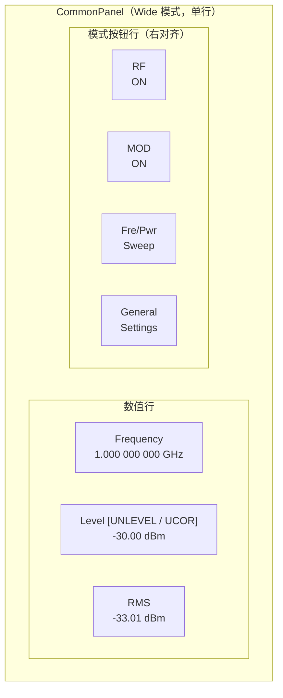
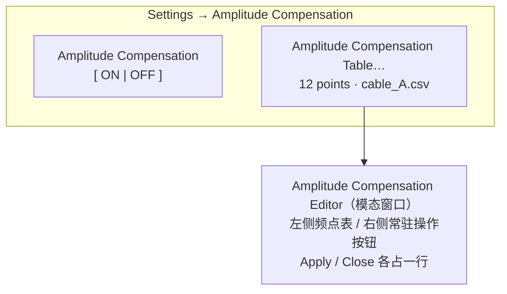
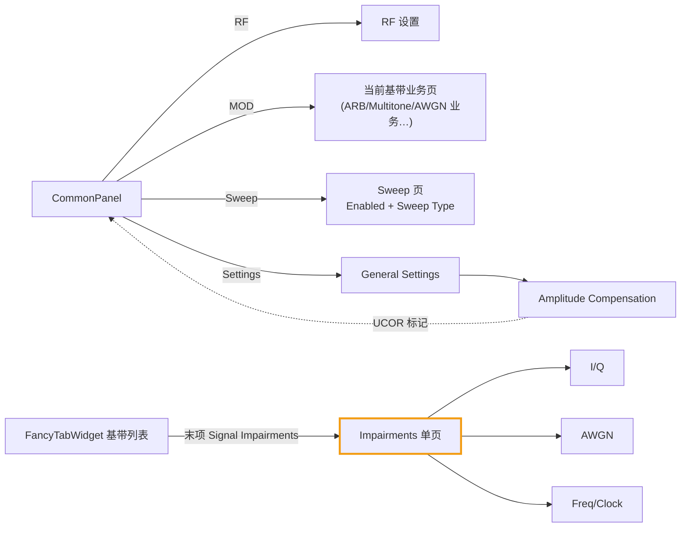

# 信号损伤 Impairments 页面：入口与交互设计

日期：2026-11-04；2026-11-10 修订。状态：UI、Amplitude Compensation（原 User Flatness）与 Freq/Clock 的设备 API 链路已静态实施，未构建或运行验收；AWGN/IQ 的前端 IQ 处理已于 2026-11-10 静态接入。

2026-11-18 右侧入口（静态实施）：信号损伤排在 FancyTabWidget 基带列表末项，随列表切换单列或双列。选中态复用列表配色。任一损伤组使能时，入口使用亮青蓝 `#00B0F0` 和深色字 `#102A1D`，以区分基带的使能配色。点击进入损伤页，损伤与基带各自保持使能状态。见 [入口恢复](../TaskLog/2026-11-18_signal-impairments-list-green.md)和[颜色调整](../TaskLog/2026-11-18_signal-impairments-enabled-cyan.md)。

2026-11-18 页内布局（静态实施）：I/Q、AWGN Noise、Freq/Clock 自上而下各占内容区全宽，组内控件参照数字波形页使用两列等权网格。见 [TaskLog](../TaskLog/2026-11-18_signal-impairments-layout-list-order.md)。

2026-11-20 状态反馈（静态实施）：I/Q 和 AWGN Noise 仅在组开启且状态为 NotApplied 或 Failed 时显示提示。Processing、Idle 和 Applied 时清空文本。I/Q 底行和 AWGN Noise 开关右侧的提示区域始终占一行，行高按当前字体计算。长提示按实际列宽显示省略号，悬停可查看完整原文。见 [移除处理中提示](../TaskLog/2026-11-20_remove-impairments-processing-label.md)和[稳定提示布局](../TaskLog/2026-11-20_stabilize-impairments-status-layout.md)。

2026-11-20 偏置与提示（静态实施）：I Offset 和 Q Offset 的输入范围为 `±20 %FS`。旧配置仍接受原合法范围，恢复值夹紧到新范围。未应用、AWGN 零信号和缓冲区错误继续反馈。DSP 输入校验失守时显示简短失败提示，具体原因写日志。取消的计算结果沿用现有丢弃规则。六套翻译目录同步删除旧提示。见 [TaskLog](../TaskLog/2026-11-20_refine-impairment-offset-and-feedback.md)。

2026-11-17 入口迁移与反馈修订（历史）：

- 信号损伤入口从 CommonPanel 移到 FancyTabWidget 列表首项，标题 `Signal Impairments`。列表重建后仍在所有基带业务之前；复用原 delegate 的选中和使能颜色。点击仅导航，不选择/取消基带业务，不触发 Auto Mod。使能色由三组开关 OR 派生，配置恢复、Reset 和页面切换沿用原语义。
- CommonPanel 删除 Impair 按钮、聚合状态刷新和旧导航接口，保留四个模式按钮，Wide 舒适宽度恢复 956 px。
- 分组标题固定为 `AWGN Noise`、`I/Q`、`Freq/Clock`。AWGN 状态在 Enabled 右侧，I/Q 状态在组内底行跨两格；纯文本 QLabel 可换行、水平 QSizePolicy::Ignored，因此完整错误不参与列宽要求。Idle/Applied 或对应组关闭时清空状态，保留 Processing / Not applied / Error 全文反馈。无需改写状态语义。
- 六品牌 Language.xlsx 各追加 20 个缺失键（13 个页面/导航/状态词条及 7 个处理错误）；既有 Bandwidth、Enabled、Frequency Error、SampleRate Error 等不改。保留各品牌语言列、隐藏标记及备注结构，中性英文版不扩充其隐藏俄文列。术语采用增益不平衡、正交相位误差、I/Q 直流偏置；参考 [Keysight I/Q 定义](https://helpfiles.keysight.com/csg/n7622/Content/Main/I_Q.htm) 和 [MathWorks AWGN / SNR](https://ww2.mathworks.cn/help/comm/ref/awgn.html)。

本段覆盖下文历史 CommonPanel 入口和标题拼接记录。第九节的布局问题已按本段实施，未采用此前跨全页提示的设计；其他未明确实施的设想仍只是方案。TaskLog：[本轮实现与静态核对](../TaskLog/2026-11-17_signal-impairments-ui-navigation-translations.md)。

2026-11-17 功率设置修订：删除全局 Level Offset 全部代码及 OFST；AMPC 更名 UCOR，UNLEVEL 优先。常量校正通过两个不同频点设置相同补偿量实现。旧配置的 LevelOffset 自然忽略。早期隐藏入口记录不代表当前仍保留该功能，当前边界见第四节。

2026-11-13 状态反馈优化设计：用户实测长错误标题造成左右列宽不一致，暗色主题中部分说明不可读。第九节给出待实施方案：固定组标题，状态全文移至跨两列、可换行的提示区；区分纯 AWGN 业务的“不适用”和 Bn>Fs 的“处理失败”，说明复数噪声带宽限制及十音示例。本轮只输出设计，尚未修改产品代码或运行验收。

2026-11-17 AWGN 文案与范围：按钮改名为 `AWGN SNR`、`AWGN Bandwidth`。带宽键盘范围随当前 Playback 采样率变化，并做双向钳位（定义见[损伤方案](signal_impairments_p0_interaction_design.md)），无额外提示。下文 3.3 的“SNR 与 Noise Bandwidth”即这两个参数。

2026-11-10 入口恢复：CommonPanel Impair 按钮重新加入按钮行并显示，Wide 舒适宽度按五个按钮恢复为 1061 px；下文 2.1/2.3 的“隐藏”“956 px”为历史状态。AWGN、I/Q 组开启时，组标题按处理状态附加 `(Processing)`、`(Not applied)` 或 `(Error: …)`，生效和关闭时不加后缀。实现见 [TaskLog](../TaskLog/2026-11-10_awgn-iq-frontend-processing.md)。实现划分见 [信号损伤方案：AWGN 与 I/Q 损伤在前端 IQ 层实现](signal_impairments_p0_interaction_design.md)（2026-11-10 起 AWGN/IQ 由前端 IQ 层实现，不再等待 FPGA），本文定义 UI 入口、页面结构、状态语义和交互规则。

2026-11-09 可见性修订：User Flatness 的 UI 显示名统一为 Amplitude Compensation，包括开关、表格入口、Editor、CSV 导入导出窗口及默认导出名。全局 Level Offset 编辑入口暂时隐藏，保留参考面换算、保存/恢复/Reset、SCPI 和 OFST 行为；不清零已有值。当时将 Impairments 页的 I/Q、AWGN 暂时隐藏，等待设备 API，只显示顶部跨两列的 Freq/Clock；同日后续已按用户要求恢复三组布局（见下文）。隐藏期间未删除控件、绑定或参数，也未改变现有三组 OR 聚合状态；翻译文件由用户更新。实现见 [TaskLog](../TaskLog/2026-11-09_amplitude-compensation-ui-visibility.md)。三组参数继续保留，Level Offset 合同已于 2026-11-17 删除。

2026-11-04 修订：Level Offset / User Flatness 移出 Impairments 页，改到 Settings 的 RF Hardware，不属于损伤分组；修改 Offset 时保持 RF 端口输出、只改显示；Frequency Offset 更名为 Frequency Error，只做 Hz；AWGN 首版只提供 SNR 与带宽；CommonPanel Level/RMS 语义不变。

同日精简修订：三组改为单页同时展示，组开关使用简单 ON/OFF SwitchButton；移除 Category、重复摘要、Actual RF / Actual Sample Rate、新增 tooltip 和 UI simulation 说明小字。参数定义先以注释保留，用户提示方式待议；独立使用 AWGN/IQ 以及旁路后恢复参数仍由各组开关表达。

2026-11-09 布局恢复：按用户要求移除 I/Q、AWGN 的显式隐藏，Freq/Clock 恢复到右下单列；原控件、参数绑定及 SampleRate Error 文案保留，未新增设备 API 行为。见 [TaskLog](../TaskLog/2026-11-09_restore-impairments-panel-layout.md)。

2026-11-09 Minibar 清理：按用户要求删除 Minibar 的 Impair 按钮、聚合状态缓存/刷新、main 订阅和损伤 IPC 字段；Minibar 不展示或编辑损伤。Main 内部页面和参数保留，CommonPanel 按钮由用户移出布局。本次不新增切入 Minibar 时清零/关闭损伤的行为。见 [TaskLog](../TaskLog/2026-11-09_remove-minibar-impairments.md)。

当前样式：I/Q、AWGN Noise、Freq/Clock 依次纵排，各自铺满滚动内容区。分组内部两列，开关和参数均为单格宽度。外层边距为 (10,0,6,10)，组间距 10 px；组内边距 (8,12,8,8)，控件间隔 5 px，按钮高 55 px。

2026-11-05 最终交互修订：用户推翻 CommonPanel 总开关提议，彻底删除总开关。CommonPanel 上方标题为 Impair，下方值标签为 ON/OFF，状态由 AWGN/IQ/Freq-Clock 三组 State 的逻辑 OR 派生；单击仍只导航。Minibar 改为只读聚合状态。Invert 保留 ON 值，但 I/Q 关闭时恢复普通外观；I/Q Offset 单位明确为 %FS。Freq/Clock 组内两项的不同适用条件见 3.5。

实施边界：`CoreRuntimeServices` 创建 `SignalImpairmentsSettings` UI owner 和独立的 `PowerReferencePlane` 幅度补偿 owner（User Flatness）；损伤 Property 不加入设备 Profile 的 ExternalPropertyMapping；Freq/Clock 的有效值经 `TxCommonSettings.frequencyClockErrors` 快照进入 TX 请求，AWGN/IQ 仍仅保存 UI 参数。`CommonDeviceProfile` 聚合保存/恢复/Reset：损伤 UI 参数保存在可选的 `common.SignalImpairmentsUi`；User Flatness 保存在 `common.UserFlatness = {Enabled, Table, File}`，草稿不持久化；加载事务开始前分别由两个 owner 校验。用户确认 d10531bc 引入的嵌套格式未发布，因此不保留该格式的迁移分支。新增 `SignalImpairmentsPanel` standalone page 和 `FlatnessTableDialog`，后者复用 Controls::Dialog、WaylandDialogMoveTool、数字键盘及 CSV 文件选择。主窗口文本/键盘统一用普通 Power，SCPI 与 Minibar 直接收发功率数值，无全局加减；MScan 草稿/已提交数据、CSV、profile 和设备请求保持原数值口径。User Flatness 已提交表与开关经 `TxCommonSettings.userFlatness` → `IDevice::Profile` 由 `FancyDevice::applyCommonDeviceSettingsLocked` 调用 `channel_config_amplitude_compensation` 下发（见 [TaskLog](../TaskLog/2026-11-05_user-flatness-api.md)，正负号与生效时机待 API 方确认）。Preset 保留已提交 Flatness 表并丢弃未应用草稿、关闭 Flatness。Minibar 不包含损伤显示、状态同步或编辑，损伤参数保留在主进程 owner。Freq/Clock 已接入设备，AWGN/IQ 尚未接入；只做静态核查。

软件参数范围集中定义在 `signalimpairmentssettings.cpp`。SNR ±100 dB、Noise Bandwidth 请求 1 Hz–1 GHz、Gain Imbalance ±20 dB、Skew ±180°、I/Q Offset ±20 %FS、Frequency Error ±1 GHz、Sample Rate Error 临时 ±100000 ppm（2026-11-09 为测试从 ±1000 扩大到 ±10%）。Flatness 2–999 点、频率 (0, 100 GHz]、校正 ±100 dB。Flatness 行数按用户明确要求为 `2 <= rows < 1000`，唯一上限定义在 `PowerReferencePlane::MaximumFlatnessPoints`。频率与校正范围仍为 UI 测试限制，API 头文件未给出完整规格。CommonPanel 的 Impair 入口已隐藏，Wide 舒适宽度按实际三数值框、四个可见按钮、间距和边距合计 956 px，较窄时使用 Compact。1024×600、Windows 最小窗口及 Wayland 触摸布局仍待运行验收。

## 一、范围

| 功能 | 位置 | 实现 | 分组 |
| --- | --- | --- | --- |
| AWGN（SNR + 带宽） | Impairments 页 | 前端 IQ 层（2026-11-10 起；处理未接入） | AWGN |
| Invert、I/Q 幅度失衡、相位失衡、I/Q Offset | Impairments 页 | 前端 IQ 层（2026-11-10 起；处理未接入） | I/Q |
| Frequency Error（Hz） | Impairments 页 | 已有 API：下发 `fc + Δf` | Freq/Clock |
| Sample Rate Error（ppm） | Impairments 页 | 已有 API：`Fs·(1+ε)` | Freq/Clock |
| Amplitude Compensation | Settings → Amplitude Compensation | 已有 API `channel_config_amplitude_compensation` | 参考面校正，非损伤 |
| Phase Noise、静态多径、Timebase Offset、频偏 ppm 模式、AWGN 噪声参考 | 不提供 | — | 不显示 |

**2026-11-09 历史可见性记录：** 当时只开放 Freq/Clock 与 Amplitude Compensation 的 UI，其他损伤页面仅调整可见性、不删除底层逻辑。2026-11-17 起 Level Offset 则已完整删除，不属于隐藏功能。

划分依据：损伤是有意劣化信号，由各组独立开关管理；Amplitude Compensation 是输出路径校正，不随损伤组开关变化。Keysight 把 Amptd Offset、Flatness 放在 Amplitude 菜单，与 I/Q 损伤、AWGN 分开，本方案保持这一分工。

## 二、历史入口：CommonPanel Impair 按钮（现已删除）

### 2.1 位置与外观

2026-11-09 按用户要求，在 [commonpanel.cpp](D:/development/vsg2.0/src/plugins/core/commonpanel.cpp) 创建 Impair 按钮后显式隐藏，并由用户移出按钮行布局，用户不再从 CommonPanel 进入信号损伤页面。可见按钮为 `RF | MOD | Sweep | Settings`，隐藏项不占布局空间，Wide/Compact 切换不重新显示它。保留按钮对象、原有信号连接、聚合状态和独立损伤页面；隐藏入口不清零已有参数，也不改变设备行为。见 [TaskLog](../TaskLog/2026-11-09_hide-commonpanel-impair-entry.md)。

- 与 `m_sweep` 相同，使用 `createExternallyCheckedPanelButton`，100 px 固定宽度、双行文字。
- 第一行（textLabel）：固定标题 `Impair`；第二行（infoLabel/value label）：`ON/OFF`，反映三组开关的 OR，与 RF 的标题在上、值在下保持一致。
- 原设计放在 Sweep 旁边；当前该位置不显示按钮，以下状态定义仍用于保留的控件。



### 2.2 按钮状态语义

沿用 Sweep 按钮的三状态模型（见 [LabelButton 状态样式](labelbutton_style_state_workflow.md)），不新增状态载体：

| 状态 | 载体 | 含义 |
| --- | --- | --- |
| checked | `setImpairHighlighted()`，由 owner 派生状态驱动 | AWGN State / I/Q State / Freq-Clock State 至少一个 ON；不代表设备确认或 RF 正在输出 |
| pageHighlighted | 动态属性，`setImpairPageHighlighted()` | 当前显示的是 Impairments 页 |
| disabled | `setEnabled(false)` | 当前 UI 测试不禁用；真实设备阶段仅在三组损伤全部不可用时禁用 |

保留的点击处理只做导航（emit `impairClicked()`），不切换任何状态；当前按钮隐藏，用户无法点击该入口。内部损伤页面仍为 I/Q、AWGN、Freq/Clock 三组同时显示，各有 Enabled，不存在隐藏总开关。组开启而数值均为中性值时，内部聚合状态仍为 ON；RF OFF 不清除组开关。已保存的 I/Q、AWGN 状态仍参与原有 OR 聚合，不因隐藏入口而被清除。

### 2.3 宽度风险

隐藏 Impair 后，Wide 模式按 4 个可见按钮计算：数值行 520 px + 按钮 400 px + 按钮间距 15 px + 两行容器间距 5 px + 外边距 16 px = 956 px；MainWindow 的 Wide 舒适宽度阈值同步为 956 px，保留原有 24 px 展开迟滞。1024×600 和 Windows 最小窗口宽度下的实际显示仍需按 [窗口尺寸合约](mainwindow_frameless_minimum_size_contract.md) 验收；本次仅静态核对。

## 三、Impairments 页面

### 3.1 结构：单页同时显示三组

- 作为独立配置页挂入 `FancyTabWidget`，从右侧基带列表末项进入，同步按钮选中态和窗口标题。
- 不提供总 Enabled；I/Q、AWGN、Freq/Clock 三个 GroupBox 同时显示，保留各自控件和绑定。
- I/Q、AWGN Noise、Freq/Clock 依次纵向排列，每个分组横向铺满内容区。
- 分组标题使用组名，各组内部使用一个简单 ON/OFF `SwitchButton`，文字统一为 `Enabled`。开关、Invert 和参数均占一个普通单格；I/Q 的开关与 Invert 同行。
- 每组内两列等权，控件横向扩展，列间距与数字波形页一致。组内按钮复用 55 px 高度规则，组开关使用 compactMode。
- 深浅主题的 GroupBox 边框/标题、按钮高度与字色、Invert 的 checked/子 label 样式直接复用设备设置页对应 QSS 声明，不额外维护另一套数值或颜色。
- 删除全页摘要、Actual RF、Actual Sample Rate 及其刷新用的 provider/名义值订阅。保留滚动容器以适应更小窗口和字体变化；1024×600 的实际显示仍待运行验收。
- 数值输入复用现有虚拟键盘与 PropertySystem 绑定，单位使用 Hz/kHz/MHz、dB、°、%FS、ppm。

| 分组（自上而下） | 左列（自上而下） | 右列（自上而下） |
| --- | --- | --- |
| I/Q | Enabled、Gain Imbalance、I Offset | Invert、Quadrature Skew、Q Offset |
| AWGN Noise | Enabled、SNR | 处理状态、Bandwidth |
| Freq/Clock | Enabled、Frequency Error | 空位、SampleRate Error |

本轮移除损伤功能新增的 tooltip 与常驻 UI simulation/说明小字，定义与适用条件先保存在代码注释和本文中。后续向用户提示的方式另行设计；Flatness 草稿/提交状态、校验和操作失败仍有反馈。

### 3.2 分组开关与独立使用

- 不提供独立总开关。`SignalImpairmentsSettings::enabled()` 只返回三组 State 的 OR，不另存聚合布尔值。
- 每组 `SwitchButton`：控制该组全部项目，三组互不排斥，也不是互斥模式。
- 仅使用 AWGN：可单独改变 SNR 考察噪声影响，同时关闭 I/Q 与 Freq/Clock，保留它们原来的参数。
- 仅使用 I/Q：可在无附加噪声时比较失衡、直流偏置或频谱翻转，同时关闭 AWGN 与 Freq/Clock。组合测试时再同时打开所需组。
- 因而保留组开关有独立用途：有限 SNR 不代表关闭 AWGN；将 I/Q 所有数值归零再恢复也不能替代保留参数的整组旁路。
- Freq/Clock 同样使用组开关，方便同时旁路和恢复两项非零误差；单个数值项以 0 表示不附加，不增设单项开关。Invert 自身是布尔参数，保留其 ON/OFF。
- 每项有效条件为所属组 ON，再结合取值与业务适用性。关闭组不改参数，所有参数仍可编辑；三个组全部 OFF 时入口为 OFF。
- 组 ON 而数值全为中性值时没有额外作用，但不自动更改用户开关或入口高亮。当前不增加解释性摘要。

### 3.3 AWGN 参数

- 首版只提供 SNR 与 Noise Bandwidth，即载波参考：噪声跟随信号电平，扫描时每点 SNR 相同。噪声参考后续作为前端换算加入（逐步改 SNR 并推导 Level，见损伤方案 2.2），不需要新 API。
- SNR 定义为 Noise Bandwidth 内的信号功率 / 噪声功率，不等同于信号占用带宽；此定义写在代码注释中。
- 初值 SNR 20 dB、Noise Bandwidth 10 MHz；真实设备阶段按 API 范围校验并回写实际带宽。
- CommonPanel Level/RMS 仍表示信号本身，不因 AWGN 开关变为加噪总功率；本页不增加总功率、噪声功率或 Eb/N0。

### 3.4 I/Q 参数

- 保留 Invert (Q)、Gain Imbalance（dB）、Quadrature Skew（°）、I/Q Offset（%FS，满量程百分比）。%FS 只明确参考量，不改变原数值或缩放。
- Invert 的 ON/OFF 值独立保存；I/Q 关闭时可保留 ON 值并编辑，但按钮背景与值区恢复普通外观。只有 I/Q Enabled 与 Invert 同为 ON 时才使用生效强调色；`effectActive` 是派生显示属性，不是另一份配置。
- Invert 在最前面将 Q 取反；后续失衡和直流偏置使用 RF 坐标。
- 正 Gain Imbalance 表示 I 路增益大于 Q 路；Skew 是理想正交关系的有符号偏差；I/Q Offset 在失衡之后施加。定义记录在注释中。
- 不增加 Carrier Leakage / Image Rejection 等依赖波形的估算读数。

### 3.5 Freq/Clock 参数

- 使用 Frequency Error 名称，Hz 输入，不提供 ppm 模式；正值提高载波频率，名义 Frequency 不变。
- FScan/MScan 不叠加 Frequency Error；Sample Rate Error 使用 ppm，目标为 `Fs·(1+ε)`，仅 Playback/Streaming 适用，CW 不适用。
- Freq/Clock 一个组开关覆盖两项，不代表二者同时适用于当前业务：FScan/MScan 下不得把 Frequency Error 呈现为已施加；CW 下不得把 Sample Rate Error 呈现为已施加。适用性分别判断，不以组 ON 替代逐项判断；切业务时保留输入值，不归零或自动关闭整组。
- 2026-11-06 已静态接入：`TxSessionService` 按组开关、载波计划和基带类型构造有效误差快照，随 `IDevice::Profile` 进入 `FancyDevice`；FFM/LScan 配置频率时加 Hz，回读时减去同一误差，名义值不重复叠加。Realtime/Playback 两个 stream helper 下发 `Fs·(1+ppm/1e6)`，`m_sampleRate` 保持名义值，覆盖普通播放、三类扫描及 Streaming 的发送重配。页面继续不展示 Actual RF / Actual Sample Rate。
- 驻留 Playback 的 FFM-only 路径把频率误差视为 FFM 变化；采样率误差变化必须重新配置 stream 并启动输出，但可复用已驻留 IQ。Streaming 通过已有 bridge 在互斥锁下传递误差值快照，worker 不读 UI owner。保存/恢复/Reset 沿用 `common.SignalImpairmentsUi`，不改格式；Minibar 无新增设置或 IPC。实现与静态核对见 [TaskLog](../TaskLog/2026-11-06_frequency-samplerate-error-and-flatness-limits.md)。
- 两项各以 0 表示无附加误差；组开关同时旁路/恢复已保存值。扫描/CW 的用户反馈方式后续统一设计，本轮不增加 tooltip 或摘要。

## 四、Amplitude Compensation（Settings 独立分组）

### 4.1 位置

设备设置页在 `Trigger Out` 下方单独显示 `Amplitude Compensation` 分组。标题复用 `Amp. Comp.` 翻译键，中文显示为「幅度补偿」。开关和补偿表入口同行，已有错误提示横跨下一行。[实现](D:/development/vsg2.0/src/plugins/core/devicesettingdialog.cpp)



Amplitude Compensation 不由损伤组开关控制，继续使用自身 ON/OFF。

Amplitude Compensation 使用 `userFlatnessBtn` 的开关样式，与 Trigger Output / Low Power / Invert Q 共用背景、checked、标题/值区间距及文字配色规则；深色主题使能为绿色，浅色主题沿用同类开关配色。按钮 checked 仍由 FlatnessEnabled 回写，启用门控不变。内部类型、对象名及 `common.UserFlatness` 配置键保持原名，CSV 列格式不变；默认导出名改为 `AmplitudeCompensation.csv`。

### 4.2 功率设置与常量补偿

2026-11-17 起删除 Level Offset 属性、隐藏 UI、SCPI、保存/恢复和全局加减换算。主窗、表格、键盘使用普通 Power，Main/Minibar/SCPI 直接使用功率数值。旧配置的 LevelOffset 自然忽略，不迁移成表，不平移已有 Level/RMS/扫描点。

常量补偿通过两个不同频点设置相同补偿量实现，沿用原提交/开启流程及频点严格递增校验。设备 API 仍是唯一补偿执行路径；前端不二次叠加表值。完整边界见 [功率设置与补偿](level_reference_plane_port_ipc_and_api_integration.md)。

### 4.3 Amplitude Compensation（内部仍称 User Flatness）

- **UCOR 标记（2026-11-17，静态实施）：** 幅度补偿启用时 Level 显示 UCOR，关闭隐藏；当前频点补偿为 0 dB 时仍显示。UNLEVEL 独占 badge，补偿变化不能覆盖它；告警解除后按当前开关恢复 UCOR。标记只表示配置启用，不表示设备执行或实测完成。Minibar 不新增状态或 IPC。见 [本次 TaskLog](../TaskLog/2026-11-17_remove-level-offset-use-ucor.md)。
- 表格在独立模态窗口中编辑（Settings 页空间不足以放整表），遵循 [qt-wayland-frameless-windows](D:/development/skills/.github/skills/qt-wayland-frameless-windows/SKILL.md) 的模态窗口规范；复用 MScan 的单元格数值键盘、选择和 CSV 导入导出，不带入 dwell 或扫描范围控件。
- 布局参考用户提供的 VSG60 截图：左侧表格，右侧直接排列 Add Row、Delete、Load、Save As、Clear，底部 Apply 和 Close 各自独占一行；不提供 Restore table 按钮或“表格操作…”菜单。Clear 只清空草稿与草稿文件名，不自动改变正在使用的曲线或开关。
- 编辑器最小宽度为 min(900 px, 创建时主窗宽度)，以保留频率/校正列的阅读空间；Controls::Dialog 显示时会 adjustSize，不能仅靠构造时 resize 设置宽度。行号列按内容紧凑自适应，不沿用 MScan 的固定 150 px；频率与校正两列平分剩余宽度。
- 样式严格复用 MScan（ListModePanel）的表格、单元格、hover/selected/disabled、表头及 Apply 按钮 QSS 声明，覆盖 12 份品牌/语言深浅主题；不复制另一套颜色。标准按钮尺寸不另行压缩，右侧按最小需要宽度排列。
- 编辑器不再设置左下角状态/提示行。未应用草稿由 Apply 的呼吸效果表达：与 MScan 相同，以 650 ms 从 opacity 0.5 到 1.0，再以 650 ms 返回 0.5，循环播放；连续编辑不重启周期。应用成功或草稿恢复为已提交内容后，停止动画、恢复 opacity=1 并禁用 Apply；初次打开已有未应用草稿时同样呼吸。
- 非空有效表格为 2–999 行，启用/CSV 导入/profile 加载复用 owner 校验；单行草稿不能应用。Add 在 999 行或两列不齐时禁用，删除或补齐后刷新。CSV 按文件顺序仅导入前 999 个数据行（不计表头与空行），保留部分校验成功后替换草稿并提示一次，其余行忽略，不修改源文件。Clear/删除只改草稿；GUI Apply 空草稿会提交空表并关闭补偿，非空 Apply 保持原开关。空表关闭状态可保存/恢复；SCPI ON 仍要求 2–999 点。校验及 CSV 读写失败使用 MScan 同类 Controls::MessageDialog，文件错误提示文件名、底层原因记日志，复用主窗口 host 与既有自销毁生命周期。常规应用/导出成功不显示额外提示；动画只表示草稿待提交，不代表设备配置过程。上述 GUI 重构及六份 Language.xlsx 三语词条已静态实施，未构建/运行，见 [TaskLog](../TaskLog/2026-11-10_flatness-gui-refactor-and-clear-apply.md)。
- 表格按 MScan 使用 Row Num 列、50 px 行高、居中数据、隐藏纵向表头、整行连续选择、逐像素滚动与触摸行为。Frequency 使用 MScan 相同的 normalizeFrequency 显示；UserRole 保留原始 Hz/dB，CSV 仍为 Frequency (Hz),Correction (dB)，不改变存储或数值精度。
- 数字键盘沿用 MScan 的单元格锚点：仍以 table 作为编辑触发对象，在 viewport 中按 visualRect(index) 创建透明、无焦点的临时 widget，并在 open 前 setAnchorWidget；主窗口继续作为 preferred overlay host。位置与边界由共享键盘处理，避免按整张表格底边弹出；anchor 随 keyboard 销毁清理。
- 2026-11-10 起，频点间按 Hz 线性插值、表外首/末两点线性外推用于软件 `CORR:VAL?` 查询；输出仍由 API 执行，不据此宣称设备算法已验证。现有输入范围为 (0,100 GHz]、±100 dB，提交 2–999 点。
- 编辑、导入、删行只改草稿；“应用表格”整表校验并提交，不逐格改变正在使用的曲线。应用不自动打开 Amplitude Compensation；没有合法已提交表时不能开启；有未应用草稿时，Settings 的 Amplitude Compensation Table 入口值区仍提示“有未应用修改”。关闭窗口保留草稿，不自动应用。
- 交给 API 执行表补偿，前端不再把表值叠加到 level 上；UCOR 只表示补偿开关，Level 数值仍保持原设置口径。

2026-11-10 幅度补偿 SCPI 已静态接入，详见 [命令与兼容边界](scpi_review_and_integration_plan.md#2026-11-10幅度补偿-rs-核心命令)。PowerReferencePlane 内草稿改为独立频率/补偿两列，SCPI 和 GUI 共用；只有提交后配对的表进入原 TX 链路。列长不同时，GUI 缺失单元格显示为空，按顺序补齐短列后才可 Add，不自动补零；Delete 同步删除两列存在的对应行，Clear 清空两列。CSV 导出拒绝不等长草稿，保留数据和目标文件，不截断；保存对话框返回后重新读取当前草稿。远程写列重建模型会使旧键盘索引失效，避免覆盖新草稿。GUI Apply 及其呼吸提示也响应 SCPI 提交。

SCPI ON 提交并启用，GUI Apply 非空表保持原开关，空表清除并关闭补偿；逻辑表名仅属会话，不改变 CSV 来源或 dirty。Reset/配置恢复清除逻辑名，Reset 保留提交表并关闭补偿、丢弃未提交编辑。用户实测 1 GHz、-20 dBm 下 +2 补偿得到 -18 dBm，支持补偿量为相对 dB；其他频点和模式尚待设备验收。本次未构建或运行。
- 2026-11-06 补齐 Streaming 传递（静态核对，未构建/运行）：`StreamingBussiness` 在既有 bridge 互斥锁下保存 `request.context.common.userFlatness`，sender 在同一锁下复制到本轮 `IDevice::Profile`，覆盖 Fixed/FScan/LScan/MScan 的基础配置。开启与关闭均传完整已提交表；worker 不访问 UI owner，不改变 Center/Level 的现有完成回写策略。见 [TaskLog](../TaskLog/2026-11-06_fix-streaming-user-flatness-transfer.md)。

## 五、生效与反馈

- 单值和开关在一次输入确认后提交，不重新生成或下载波形；不增加全页 Apply。Flatness 整表保留独立“应用表格”，这是数据完整性边界。实际生效、下次启动生效和适用性限制的用户提示方式待 API 接入时统一设计。
- 当前测试只在 UI 中保存参数和提交表格，不调用设备配置接口；已移除摘要和“UI 模拟”说明。真实设备回写以 API 确认/查询为准（实际带宽、clip 计数）。
- 告警：数字饱和、开启 AWGN 后电平不足（UNLEVEL）进入现有设备状态反馈链（见 [设备状态 UI 反馈](device_status_ui_feedback.md)），Level 上的 UNLEVEL badge 照常显示。
- 真实设备阶段：新增损伤按 impairment capabilities 开放；Frequency Error、Sample Rate Error、Flatness 按各自 API/业务适用性开放。

## 六、与其他入口的一致性

- 参数 owner：损伤 UI 和 SCPI 参数由 core 侧 `SignalImpairmentsSettings` 持有；User Flatness 由 `PowerReferencePlane` 持有；CoreRuntimeServices 创建服务，PropertyManager 持有 Property，CommonDeviceProfile 聚合持久化。损伤页面只做输入适配，校验规则在 owner；Minibar 不接入损伤状态或编辑。既有绝对功率 SCPI 已使用统一参考面，User Flatness 与 Freq/Clock 已接入设备。
- Preset / Reset：三组 State、Invert 恢复 OFF，误差/失衡/Offset 恢复 0，SNR/带宽恢复默认值；User Flatness 恢复 OFF、保留已提交表并由其恢复草稿，清除 SCPI 逻辑表名；工厂校准不受影响。设备重连后由前端恢复保存值。
- 保存：新配置不再写 `SignalImpairmentsUi.Enabled`。读取已有 UI 测试配置时，旧 Enabled 必须为数值 0/1；若为 0，恢复时关闭三个组并保留各数值，维持原旁路状态，避免加载后意外开启。若为 1，按已保存组状态恢复。不额外保存“上次启用组合”。
- Minibar：不包含损伤按钮、聚合状态或编辑，也不传输损伤 IPC 字段；RemoteMinibarService 不再直接订阅损伤 owner。Main 参数、持久化和 TX/API 链路独立保留。
- SCPI 已接入 12 对设置与查询，适用范围和保存边界见 [信号损伤 SCPI 接口设计](signal_impairments_scpi_design.md)。设备验收待执行。

## 七、整体导航关系



信号处理顺序（决定 UI 上参数的定义坐标系）：


注意：现有 `AwgnModulation`（[awgnmodulation.h](D:/development/vsg2.0/src/plugins/htra/awgnmodulation.h)）是“纯噪声波形”业务，与本页“叠加在信号上的 AWGN”不同，两者共存；该区别目前写在代码注释中，页面组名为 AWGN Noise。

## 八、真实设备接入前待确认

1. API 修改参数是否在输出中立即生效，以及旁路、业务不适用、待生效等状态如何向用户提示。
2. UI owner 已放在 core；真实设备接入后的设备线程/确认回写边界待定。
3. 当前按四个可见按钮静态核算宽度，仍需目标屏幕实测。
4. Preset 保留已提交 Flatness 表、关闭开关并恢复草稿已按 2026-11-10 授权合同保留，运行验收待执行。

## 九、状态提示布局与 AWGN 带宽限制优化设计

日期：2026-11-13。状态：待实施。依据当前分支 `eb0c2233` 及用户提供的截图/操作反馈；本节替代的是“将状态全文追加到 GroupBox 标题”的交互方案，不表示代码已经更改。

### 9.1 当前出现的两种情况

| 操作 | 当前代码状态 | 实际含义 |
| --- | --- | --- |
| 基带选择纯 AWGN，损伤 AWGN 或 I/Q 组 ON | `NotApplied` | 当前产品不对纯噪声源追加这两组损伤，纯噪声业务正常输出；不是带宽错误，也不是计算得到零信号 |
| 支持的离线 Playback 上开启 AWGN，Bn>该波形 Fs | `Failed` | 不能在当前采样率下生成所要求的噪声总带宽，损伤记录不下发；需修改带宽或波形 |

纯 AWGN 的明确旁路来自 [awgnmodulation.h](/D:/development/vsg2.0/src/plugins/htra/awgnmodulation.h:39) 的 `supportsIqImpairments()=false`，由 [TX 分派](/D:/development/vsg2.0/src/plugins/core/txsessionservice.cpp:790) 调用 `markNotApplied()`。纯噪声有 RMS，但本功能的 SNR 参考是有用信号功率与新增噪声功率；本版没有定义“以现有纯噪声为信号再加噪”的产品模式。I/Q 也随当前能力合同旁路，这不是说物理上无法对噪声做 I/Q 变换。

Bn>Fs 的失败来自 [iqimpairments.cpp](/D:/development/vsg2.0/src/libs/utils/iqimpairments.cpp:267)。当前原文是 `Noise bandwidth must not exceed the sample rate (%1 Hz)`，其中 `%1` 是本次处理记录的采样率。页面应把这个失败完整显示出来，不能让用户只看到组开关仍为 ON。

### 9.2 布局和颜色

三个组标题始终只显示 `I/Q`、`AWGN`、`Freq/Clock`，不包含 Processing、Not applied 或错误正文。当前 [updateTitles](/D:/development/vsg2.0/src/plugins/core/signalimpairmentspanel.cpp:135) 的长标题会增加所在组的最小宽度；外层即使设置两列 stretch=1:1，也不能忽略这种内容最小宽度。

在滚动内容顶部、三组控件之前放一个横跨两列的状态文本区域。没有待处理状态时隐藏；有状态时占满可用宽度，正文自动换行，只增加行高，不增加某一列的最小宽度。原有 I/Q 左列跨两行、AWGN 右上、Freq/Clock 右下布局和组内参数位置保持。

```text
┌─────────────────────────────────────────────────────────┐
│ AWGN：噪声带宽 66 MHz 超过当前波形采样率 65 MSa/s。       │
│ 请将噪声带宽设为不大于 65 MHz，或使用更高采样率的波形。  │
└─────────────────────────────────────────────────────────┘
┌──────────── I/Q ────────────┐ ┌──────── AWGN ────────────┐
│ Enabled       Invert       │ │ Enabled                  │
│ Gain          Skew         │ │ SNR        Noise BW      │
│ I Offset      Q Offset     │ └──────────────────────────┘
│                            │ ┌────── Freq/Clock ────────┐
│                            │ │ Enabled                  │
│                            │ │ Freq Error   Rate Error  │
└────────────────────────────┘ └──────────────────────────┘
```

提示控件采用普通 `QLabel`、`PlainText` 和 wordWrap；横向 size policy 使用 Ignored，使长文本不参与撑宽约束；纵向按实际换行高度布局。不要通过固定整列宽度、裁断错误正文或缩小参数字号解决问题。提示区在滚动内容内，窄屏必要时增加纵向滚动。

深浅色文字在主题 CSS 中显式指定，不在 C++ 硬编码。普通处理状态和不适用说明使用主题正文色；真正的失败使用已有警告配色：暗色可复用清晰的浅黄，浅色使用对比充分的深红。组标题继续使用主题标题色，并检查 QGroupBox 本体及标题绘制均可读。样式选择器限定到本页的提示 label，避免影响按钮内部 QLabel。12 份品牌/语言深浅主题一起调整，状态文案进入既有三语 Language.xlsx。

用户反馈的黑字是有效的视觉缺陷证据；尚未运行复现，不把具体 palette 或 QSS 匹配原因当成已确认根因。独立 label 的显式主题规则提供直接的修复边界。

### 9.3 状态文案和行为

| 状态 | 提示示例 | 行为 |
| --- | --- | --- |
| 两组 OFF，或 Idle | 不显示提示 | 保存各输入；原有旁路和静音语义不变 |
| Processing | `AWGN / I/Q：正在生成损伤波形…` | 只列当前开启的组；不显示模态弹窗，不输出干净波形替代 |
| NotApplied，纯 AWGN | `未应用：纯噪声 AWGN 基带不支持此损伤，请选择支持的离线 Playback 信号。` | 普通说明色；组值保留，纯噪声业务继续；不能标成“错误” |
| NotApplied，其他不适用路径 | `未应用：当前输出模式不支持离线 IQ 损伤。`，附具体模式原因 | 保留输入，不自动切换基带或关闭组 |
| Failed，带宽超限 | `AWGN：噪声带宽 66 MHz 超过当前波形采样率 65 MSa/s。请将带宽设为不大于 65 MHz，或使用更高采样率的波形。` | 警告色；保留请求值，修正后自动重新处理 |
| Applied | 清除提示 | 只说明损伤副本已生成；不把此处理器状态宣称为设备已输出或 RF 实测通过 |

两组共享一条损伤处理记录。如果 AWGN 参数非法导致生成失败，即使 I/Q 参数合法，也不能暗中下发“仅 I/Q”或干净波形；提示只显示一次，并指出失败原因在 AWGN，避免两个组标题重复同一条错误。Freq/Clock 不作为 AWGN/IQ 处理器错误的归属组。

校验继续在 DSP/处理 owner 完成，页面展示其状态及原因，不复制一套 Bn/Fs 业务校验。NotApplied 原因由了解业务适用性的 TX/processor 边界提供，页面不自行按业务名称重新判定。状态正文应对应本次请求/结果快照，尤其是其中的 Fs；不能用后一次 UI 采样率覆盖旧结果中的数值。沿用既有 generation 相关性，不新增锁、轮询或重试队列。

### 9.4 为什么限制 Bn 不大于 Fs

这里的 Fs 是**当前离线 IQ 波形的复采样率**，不是设备最高采样率；Bn 是以基带 0 Hz 为中心的**噪声双边总宽度**，不是单边截止频率，也不是信号占用带宽。

```text
复数离散 IQ 的一个不重复频率区间：[-Fs/2, +Fs/2)
请求的噪声频带：                  [-Bn/2, +Bn/2]
必须满足：Bn/2 ≤ Fs/2，即 Bn ≤ Fs
```

当前实现把噪声加在同一条 IQ 数组里，信号和噪声使用相同 Fs。若 Bn>Fs，超出 Nyquist 区间的噪声会折叠进来，无法形成所要求的独立总带宽，噪声带宽与 SNR 积分定义也会失真。因此当前代码拒绝，而不是静默裁到 Fs。

这不是要求 `Bn≤Fs/2`：Fs/2 是每侧的上限，两侧合计总带宽为 Fs。Bn=Fs 时代码使用未低通的白噪声路径，数学上允许；靠近 Nyquist 边缘的实际射频平坦度仍受硬件重建链路影响，应另按测试方案验收。

### 9.5 Count 为 10 且 Spacing 为 5 MHz 的例子

按本分支默认中心音遮盖开启、十根候选音全部启用，基带频率为：

```text
-25, -20, -15, -10, -5, 0, 5, 10, 15, 20 MHz
最大绝对基带频率 = 25 MHz
生成器最低 Fs = 1.25 × 2 × 25 MHz = 62.5 MSa/s
当前规划器优先取 5 MHz 的整数倍：若设备支持，通常 Fs = 65 MSa/s
```

这里的向上对齐是现有多音采样率选择器的策略，**不是 AWGN 新增要求，也不是保证循环记录连续的数学必要条件**。`lowestAlignedSampleRate()` 的优先调用从 `7c117252`（2026-07-17）就已存在，11 月 10 日损伤提交没有修改这段采样率规划。

精确循环真正要求每个音满足 `N·f/Fs` 为整数，其中 N 是整条记录样点数。Fs=62.5 MSa/s、基频 5 MHz 时，每个周期为 12.5 个样点，但两个周期恰好是 25 个样点，因此 N 取 25 的倍数同样可以精确循环。Fs=65 MSa/s 则每周期为 13 个样点。当前 `chooseSampleCount()` 本身已支持有理数周期；所以不能将 62.5 MSa/s 说成不合法，或声称为了 AWGN 必须抬高到 65。

依据：[生成需求](/D:/development/vsg2.0/src/plugins/htra/multitonegenerator.cpp:505)、[采样率规划](/D:/development/vsg2.0/src/plugins/htra/multitonemodulation.cpp:109)。在该条件下，66 MHz 噪声要求 ±33 MHz，而 65 MSa/s 的记录只能表示 ±32.5 MHz，因此超出 1 MHz 总宽度。

这是代码条件推导，不是从截图中读到了 65 MSa/s。用户补充此前无损伤时实际为 62.5 MSa/s；该值数学上有效，不能归因于“开启损伤导致采样率上调”。此前具体版本、设备能力或规划路径尚未定位。若禁用部分音、加载旧 mask 配置，或设备采样率能力不同，实际 Fs 也可能不同；错误文案和判定必须使用本次实际 provider Fs。设备即使支持 125/200/400 MSa/s，也不能让一条仍以 65 MSa/s 播放的 IQ 记录直接表示 66 MHz 噪声；若实际 Fs=62.5 MSa/s，噪声总带宽上限就是 62.5 MHz。

对这个例子，当前最直接的操作是把噪声带宽降到实际 Fs 以内，例如确认 Fs=65 MSa/s 后设 64 MHz，并验收噪声过渡带和硬件边缘表现。若测试必须使用 66 MHz 噪声，应改用实际 Fs≥66 MSa/s 的支持波形。

如果以后要求 AWGN 带宽自动抬高 Multitone Fs，需要让带宽参与原始波形规划，在设备允许范围内求满足信号、噪声、精确周期和容量的共同采样率，然后重新生成、处理和下载。当前 Core 后处理无法仅修改 Fs 数字来完成：直接改变播放率会连带改变原多音频率；仅补零增加 N 也不会扩大采样带宽。本轮不引入这种跨来源自动重规划。

另外，过窄带宽是另一类失败。现有 Blackman FIR 设计将抽头数限制为 8191，在当前过渡带要求下近似要求 `Bn≥27.5·Fs/8191`；超出计算能力时显示实际最小带宽及“带宽过窄”原因，不与 Bn>Fs 混用同一说明。

### 9.6 实施边界和验收

拟修改页面的标题刷新逻辑，增加一个跨列状态 label；processor 沿用现有 State，提供不适用原因及失败详情；DSP 带宽超限文案补齐请求带宽、实际 Fs 和改正方法。配套同步 12 份主题和三语翻译。不新增总开关、全页 Apply、派生功率读数、模态提示或损伤 SCPI。

验收顺序：

1. 打开两组并制造最长错误；检查三个标题始终固定，左右列宽不因错误正文长度或提示语言变化而重新分配，正文完整换行。
2. 在暗/亮主题及 1024×600、Windows 窗口中检查普通、不适用、错误三种文本均可读；提示只影响高度，不裁参数按钮。
3. 纯 AWGN 基带 + 损伤组 ON：显示未应用及纯噪声原因，纯噪声继续输出；不出现错误警告。
4. 普通 Multitone 获取实际 Fs 后令 Bn>Fs：显示请求值和该 Fs；两组均 ON 时只显示一次失败，不下发干净或仅 I/Q 波形。
5. Bn 修正为合法值后自动经过 Processing 并清除提示；再关闭 AWGN，保留其超限输入但仅使用 I/Q 时不应继续被 AWGN 参数阻断。
6. 检查 Bn=Fs 允许白噪声路径、过窄带宽显示不同原因；正常配置不因本次 UI 调整改变 DSP 结果。
7. 处理中切换业务/Fs，确认提示最终属于最新请求；关闭组、返回支持业务、重新连接后的文字与状态一致。

相关：[实现审查与测试方案](awgn_iq_impairments_review_and_test_plan.md)、[本次 TaskLog](../TaskLog/2026-11-13_impairments-status-layout.md)。
