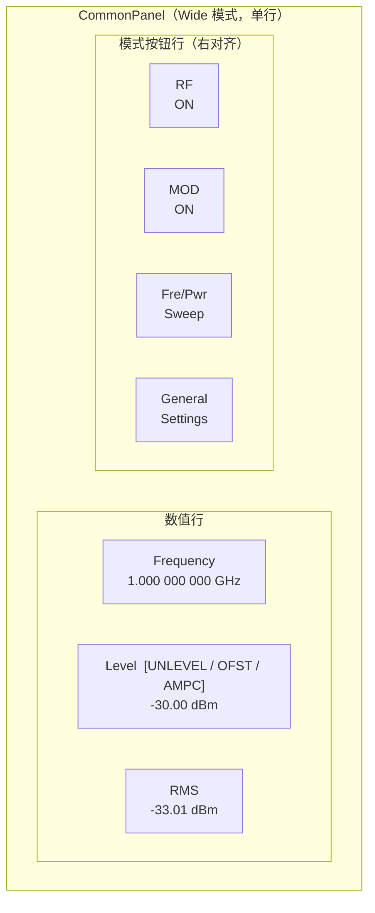
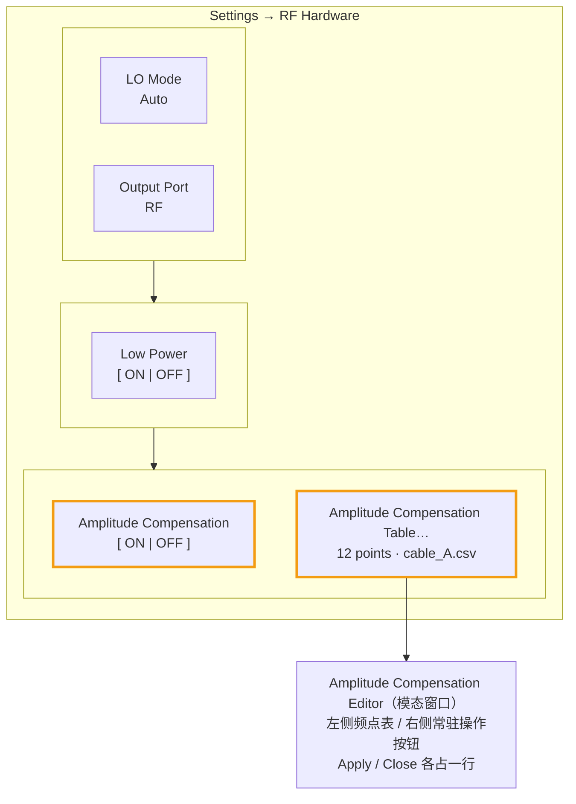
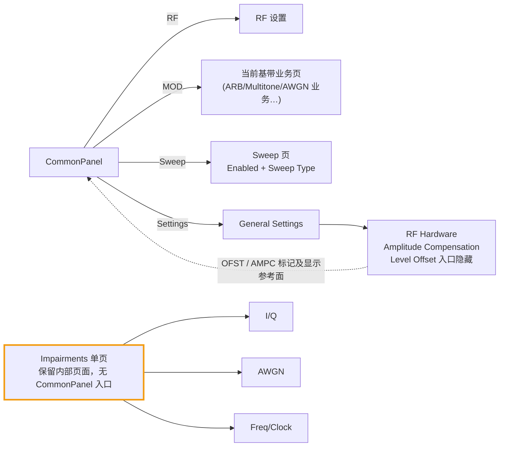

# 信号损伤 Impairments 页面：入口与交互设计

日期：2026-11-04；2026-11-10 修订。状态：UI、Amplitude Compensation（原 User Flatness）与 Freq/Clock 的设备 API 链路已静态实施，未构建或运行验收；AWGN/IQ 的前端 IQ 处理已于 2026-11-10 静态接入。

2026-11-10 入口恢复：CommonPanel Impair 按钮重新加入按钮行并显示，Wide 舒适宽度按五个按钮恢复为 1061 px；下文 2.1/2.3 的“隐藏”“956 px”为历史状态。AWGN、I/Q 组开启时，组标题按处理状态附加 `(Processing)`、`(Not applied)` 或 `(Error: …)`，生效和关闭时不加后缀。实现见 [TaskLog](../TaskLog/2026-11-10_awgn-iq-frontend-processing.md)。实现划分见 [信号损伤方案：AWGN 与 I/Q 损伤在前端 IQ 层实现](signal_impairments_p0_interaction_design.md)（2026-11-10 起 AWGN/IQ 由前端 IQ 层实现，不再等待 FPGA），本文定义 UI 入口、页面结构、状态语义和交互规则。

2026-11-09 可见性修订：User Flatness 的 UI 显示名统一为 Amplitude Compensation，包括开关、表格入口、Editor、CSV 导入导出窗口及默认导出名。全局 Level Offset 编辑入口暂时隐藏，保留参考面换算、保存/恢复/Reset、SCPI 和 OFST 行为；不清零已有值。当时将 Impairments 页的 I/Q、AWGN 暂时隐藏，等待设备 API，只显示顶部跨两列的 Freq/Clock；同日后续已按用户要求恢复三组布局（见下文）。隐藏期间未删除控件、绑定或参数，也未改变现有三组 OR 聚合状态；翻译文件由用户更新。实现见 [TaskLog](../TaskLog/2026-11-09_amplitude-compensation-ui-visibility.md)。下文保留的三组参数与 Level Offset 语义仍是底层合同。

2026-11-04 修订：Level Offset / User Flatness 移出 Impairments 页，改到 Settings 的 RF Hardware，不属于损伤分组；修改 Offset 时保持 RF 端口输出、只改显示；Frequency Offset 更名为 Frequency Error，只做 Hz；AWGN 首版只提供 SNR 与带宽；CommonPanel Level/RMS 语义不变。

同日精简修订：三组改为单页同时展示，组开关使用简单 ON/OFF SwitchButton；移除 Category、重复摘要、Actual RF / Actual Sample Rate、新增 tooltip 和 UI simulation 说明小字。参数定义先以注释保留，用户提示方式待议；独立使用 AWGN/IQ 以及旁路后恢复参数仍由各组开关表达。

2026-11-09 布局恢复：按用户要求移除 I/Q、AWGN 的显式隐藏，Freq/Clock 恢复到右下单列；原控件、参数绑定及 SampleRate Error 文案保留，未新增设备 API 行为。见 [TaskLog](../TaskLog/2026-11-09_restore-impairments-panel-layout.md)。

2026-11-09 Minibar 清理：按用户要求删除 Minibar 的 Impair 按钮、聚合状态缓存/刷新、main 订阅和损伤 IPC 字段；Minibar 不展示或编辑损伤。Main 内部页面和参数保留，CommonPanel 按钮由用户移出布局。本次不新增切入 Minibar 时清零/关闭损伤的行为。见 [TaskLog](../TaskLog/2026-11-09_remove-minibar-impairments.md)。

当前样式：I/Q 位于左列跨两行，AWGN 位于右上，Freq/Clock 位于右下，三组同时显示。不显示总开关或 General GroupBox。分组内部两列，开关和参数均为单格宽度。分组区域外层边距/组间距 10 px，组内边距 (8,12,8,8)、间距 8 px，按钮高 55 px；12 份主题复用设备设置页的边框、标题、按钮与 Invert 状态声明。

2026-11-05 最终交互修订：用户推翻 CommonPanel 总开关提议，彻底删除总开关。CommonPanel 上方标题为 Impair，下方值标签为 ON/OFF，状态由 AWGN/IQ/Freq-Clock 三组 State 的逻辑 OR 派生；单击仍只导航。Minibar 改为只读聚合状态。Invert 保留 ON 值，但 I/Q 关闭时恢复普通外观；I/Q Offset 单位明确为 %FS。Freq/Clock 组内两项的不同适用条件见 3.5。

实施边界：`CoreRuntimeServices` 创建 `SignalImpairmentsSettings` UI owner 和独立的 `PowerReferencePlane` 输出参考面 owner（Level Offset + User Flatness）；损伤 Property 不加入设备 Profile 的 ExternalPropertyMapping；Freq/Clock 的有效值经 `TxCommonSettings.frequencyClockErrors` 快照进入 TX 请求，AWGN/IQ 仍仅保存 UI 参数。`CommonDeviceProfile` 聚合保存/恢复/Reset：损伤 UI 参数保存在可选的 `common.SignalImpairmentsUi`；Level Offset 保存在 `common.LevelOffset`（属性 ID `LevelOffset`，缺失时恢复 0）；User Flatness 保存在 `common.UserFlatness = {Enabled, Table, File}`，草稿不持久化；加载事务开始前分别由两个 owner 校验。用户确认 d10531bc 引入的嵌套格式未发布，因此不保留该格式的迁移分支。新增 `SignalImpairmentsPanel` standalone page 和 `FlatnessTableDialog`，后者复用 Controls::Dialog、WaylandDialogMoveTool、数字键盘及 CSV 文件选择。主窗口文本/键盘通过 `ReferencedPower` 换算，SCPI 在外部数值协议边界换算，Minibar 由 Core 侧 `RemoteMinibarService` 在 IPC 出入口换算（helper 只收发用户参考面值，Offset 变化时递增 Sweep revision）；MScan 草稿/已提交数据、原有 CSV、profile 与设备链路继续存 RF 端口电平。User Flatness 已提交表与开关经 `TxCommonSettings.userFlatness` → `IDevice::Profile` 由 `FancyDevice::applyCommonDeviceSettingsLocked` 调用 `channel_config_amplitude_compensation` 下发（见 [TaskLog](../TaskLog/2026-11-05_user-flatness-api.md)，正负号与生效时机待 API 方确认）。Preset 保留已提交 Flatness 表并丢弃未应用草稿、关闭 Flatness。Minibar 不包含损伤显示、状态同步或编辑，损伤参数保留在主进程 owner。Freq/Clock 已接入设备，AWGN/IQ 尚未接入；只做静态核查。

当前 UI 测试范围集中定义在 `signalimpairmentssettings.cpp`，不是仪器规格：SNR ±100 dB、Noise Bandwidth 1 Hz–1 GHz、Gain Imbalance ±20 dB、Skew ±180°、I/Q Offset ±100%、Frequency Error ±1 GHz、Sample Rate Error 临时 ±100000 ppm（2026-11-09 为测试从 ±1000 扩大，±10%）；Flatness 2–999 点、频率 (0, 100 GHz]、校正 ±100 dB。Level Offset ±100 dB 由 `powerreferenceplane.cpp` 定义。Flatness 行数按用户明确要求为 `2 <= rows < 1000`，唯一上限定义在 `PowerReferencePlane::MaximumFlatnessPoints`；频率/校正范围仍为 UI 测试限制，API 头文件未给出完整规格。CommonPanel 的 Impair 入口已隐藏，Wide 舒适宽度按实际三数值框、四个可见按钮、间距和边距合计 956 px，较窄时使用 Compact；1024×600、Windows 最小窗口及 Wayland 触摸布局仍待运行验收。

## 一、范围

| 功能 | 位置 | 实现 | 分组 |
| --- | --- | --- | --- |
| AWGN（SNR + 带宽） | Impairments 页 | 前端 IQ 层（2026-11-10 起；处理未接入） | AWGN |
| Invert、I/Q 幅度失衡、相位失衡、I/Q Offset | Impairments 页 | 前端 IQ 层（2026-11-10 起；处理未接入） | I/Q |
| Frequency Error（Hz） | Impairments 页 | 已有 API：下发 `fc + Δf` | Freq/Clock |
| Sample Rate Error（ppm） | Impairments 页 | 已有 API：`Fs·(1+ε)` | Freq/Clock |
| Level Offset | Settings → RF Hardware（入口暂时隐藏） | 显示/输入边界换算；设备 API 保持端口值 | 参考面校正，非损伤 |
| Amplitude Compensation | Settings → RF Hardware | 已有 API `channel_config_amplitude_compensation` | 参考面校正，非损伤 |
| Phase Noise、静态多径、Timebase Offset、频偏 ppm 模式、AWGN 噪声参考 | 不提供 | — | 不显示 |

**当前只开放 Freq/Clock 与 Amplitude Compensation 的 UI。** AWGN/IQ 等待前端 IQ 处理接入（2026-11-10 起不再等待 API），Level Offset 等待后续重构决定；本轮仅调整可见性，不删除背后的逻辑，页面不显示“UI 模拟”说明。

划分依据：损伤是有意劣化信号，由各组独立开关管理；Level Offset / Flatness 是输出参考面与路径校正，不随损伤组开关变化。Keysight 把 Amptd Offset、Flatness 放在 Amplitude 菜单，与 I/Q 损伤、AWGN 分开，本方案保持这一分工。

## 二、入口：CommonPanel Impair 按钮（当前隐藏）

### 2.1 位置与外观

2026-11-09 按用户要求，在 [commonpanel.cpp](D:/development/vsg2.0/src/plugins/core/commonpanel.cpp) 创建 Impair 按钮后显式隐藏，并由用户移出按钮行布局，用户不再从 CommonPanel 进入信号损伤页面。可见按钮为 `RF | MOD | Sweep | Settings`，隐藏项不占布局空间，Wide/Compact 切换不重新显示它。保留按钮对象、原有信号连接、聚合状态和独立损伤页面；隐藏入口不清零已有参数，也不改变设备行为。见 [TaskLog](../TaskLog/2026-11-09_hide-commonpanel-impair-entry.md)。

- 与 `m_sweep` 相同，使用 `createExternallyCheckedPanelButton`，100 px 固定宽度、双行文字。
- 第一行（textLabel）：固定标题 `Impair`；第二行（infoLabel/value label）：`ON/OFF`，反映三组开关的 OR，与 RF 的标题在上、值在下保持一致。
- 原设计放在 Sweep 旁边；当前该位置不显示按钮，以下状态定义仍用于保留的控件。



### 2.2 按钮状态语义

沿用 Sweep 按钮的三状态模型（见 [LabelButton 状态样式](labelbutton_style_state_workflow.md)），不新增状态载体：

| 状态 | 载体 | 含义 |
| --- | --- | --- |
| checked | `setImpairHighlighted()`，由 owner 派生状态驱动 | AWGN State / I/Q State / Freq-Clock State 至少一个 ON；不代表设备确认或 RF 正在输出 |
| pageHighlighted | 动态属性，`setImpairPageHighlighted()` | 当前显示的是 Impairments 页 |
| disabled | `setEnabled(false)` | 当前 UI 测试不禁用；真实设备阶段仅在三组损伤全部不可用时禁用 |

保留的点击处理只做导航（emit `impairClicked()`），不切换任何状态；当前按钮隐藏，用户无法点击该入口。内部损伤页面仍为 I/Q、AWGN、Freq/Clock 三组同时显示，各有 Enabled，不存在隐藏总开关。组开启而数值均为中性值时，内部聚合状态仍为 ON；RF OFF 不清除组开关。已保存的 I/Q、AWGN 状态仍参与原有 OR 聚合，不因隐藏入口而被清除。

### 2.3 宽度风险

隐藏 Impair 后，Wide 模式按 4 个可见按钮计算：数值行 520 px + 按钮 400 px + 按钮间距 15 px + 两行容器间距 5 px + 外边距 16 px = 956 px；MainWindow 的 Wide 舒适宽度阈值同步为 956 px，保留原有 24 px 展开迟滞。1024×600 和 Windows 最小窗口宽度下的实际显示仍需按 [窗口尺寸合约](mainwindow_frameless_minimum_size_contract.md) 验收；本次仅静态核对。

## 三、Impairments 页面

### 3.1 结构：单页同时显示三组

- 作为 standalone page 挂入 `FancyTabWidget`，`MainWindow::showImpairmentsPage()` 与 Sweep 页同模式；同步 pageHighlighted 与窗口标题。
- 不提供总 Enabled；I/Q、AWGN、Freq/Clock 三个 GroupBox 同时显示，保留各自控件和绑定。
- I/Q 位于左列跨两行，AWGN 位于右上，Freq/Clock 位于右下；不提供 Category 或 stacked 子页。
- 分组标题使用组名，各组内部使用一个简单 ON/OFF `SwitchButton`，文字统一为 `Enabled`。开关、Invert 和参数均占一个普通单格；I/Q 的开关与 Invert 同行。
- 每组内两列等权。分组区域外层边距 10 px、组间距 10 px；组内边距 (8,12,8,8)、按钮间距 8 px，与设备设置页一致。组内按钮复用 55 px 高度规则，组开关使用已有 compactMode 适应单格宽度。
- 深浅主题的 GroupBox 边框/标题、按钮高度与字色、Invert 的 checked/子 label 样式直接复用设备设置页对应 QSS 声明，不额外维护另一套数值或颜色。
- 删除全页摘要、Actual RF、Actual Sample Rate 及其刷新用的 provider/名义值订阅。保留滚动容器以适应更小窗口和字体变化；1024×600 的实际显示仍待运行验收。
- 数值输入复用现有虚拟键盘与 PropertySystem 绑定，单位使用 Hz/kHz/MHz、dB、°、%FS、ppm。

| 行 | 左侧 | 右侧 |
| --- | --- | --- |
| 分组上部 | I/Q（跨两行）：Enabled / Invert；Gain Imbalance / Quadrature Skew；I Offset / Q Offset | AWGN：Enabled / 空位；SNR / Noise Bandwidth |
| 分组下部 | I/Q 延续 | Freq/Clock：Enabled / 空位；Frequency Error / SampleRate Error |

本轮移除损伤功能新增的 tooltip 与常驻 UI simulation/说明小字，定义与适用条件先保存在代码注释和本文中。后续向用户提示的方式另行设计；Flatness 草稿/提交状态、校验和操作失败仍有反馈。

### 3.2 分组开关与独立使用

- 不提供独立总开关。`SignalImpairmentsSettings::enabled()` 只返回三组 State 的 OR，不另存聚合布尔值。
- 每组 `SwitchButton`：控制该组全部项目，三组互不排斥，也不是互斥模式。
- 仅使用 AWGN：可单独改变 SNR 考察噪声影响，同时关闭 I/Q 与 Freq/Clock，保留它们原来的参数。
- 仅使用 I/Q：可在无附加噪声时比较失衡、直流偏置或频谱翻转，同时关闭 AWGN 与 Freq/Clock。组合测试时再同时打开所需组。
- 因而保留组开关有独立用途：有限 SNR 不代表关闭 AWGN；将 I/Q 所有数值归零再恢复也不能替代保留参数的整组旁路。
- Freq/Clock 同样使用组开关，方便同时旁路和恢复两项非零误差；单个数值项以 0 表示不附加，不增设单项开关。Invert 自身是布尔参数，保留其 ON/OFF。
- 每项有效条件为所属组 ON，再结合取值与业务适用性。关闭组不改参数，所有参数仍可编辑；三个组全部 OFF 时入口为 OFF。
- 组 ON 而数值全为中性值时没有额外作用，但不自动更改用户开关或入口高亮。当前不增加解释性摘要。

### 3.3 AWGN 参数

- 首版只提供 SNR 与 Noise Bandwidth，即载波参考：噪声跟随信号电平，扫描时每点 SNR 相同。噪声参考后续作为前端换算加入（逐步改 SNR 并推导 Level，见损伤方案 2.2），不需要新 API。
- SNR 定义为 Noise Bandwidth 内的信号功率 / 噪声功率，不等同于信号占用带宽；此定义写在代码注释中。
- 初值 SNR 20 dB、Noise Bandwidth 10 MHz；真实设备阶段按 API 范围校验并回写实际带宽。
- CommonPanel Level/RMS 仍表示信号本身，不因 AWGN 开关变为加噪总功率；本页不增加总功率、噪声功率或 Eb/N0。

### 3.4 I/Q 参数

- 保留 Invert (Q)、Gain Imbalance（dB）、Quadrature Skew（°）、I/Q Offset（%FS，满量程百分比）。%FS 只明确参考量，不改变原数值或缩放。
- Invert 的 ON/OFF 值独立保存；I/Q 关闭时可保留 ON 值并编辑，但按钮背景与值区恢复普通外观。只有 I/Q Enabled 与 Invert 同为 ON 时才使用生效强调色；`effectActive` 是派生显示属性，不是另一份配置。
- Invert 在最前面将 Q 取反；后续失衡和直流偏置使用 RF 坐标。
- 正 Gain Imbalance 表示 I 路增益大于 Q 路；Skew 是理想正交关系的有符号偏差；I/Q Offset 在失衡之后施加。定义记录在注释中。
- 不增加 Carrier Leakage / Image Rejection 等依赖波形的估算读数。

### 3.5 Freq/Clock 参数

- 使用 Frequency Error 名称，Hz 输入，不提供 ppm 模式；正值提高载波频率，名义 Frequency 不变。
- FScan/MScan 不叠加 Frequency Error；Sample Rate Error 使用 ppm，目标为 `Fs·(1+ε)`，仅 Playback/Streaming 适用，CW 不适用。
- Freq/Clock 一个组开关覆盖两项，不代表二者同时适用于当前业务：FScan/MScan 下不得把 Frequency Error 呈现为已施加；CW 下不得把 Sample Rate Error 呈现为已施加。适用性分别判断，不以组 ON 替代逐项判断；切业务时保留输入值，不归零或自动关闭整组。
- 2026-11-06 已静态接入：`TxSessionService` 按组开关、载波计划和基带类型构造有效误差快照，随 `IDevice::Profile` 进入 `FancyDevice`；FFM/LScan 配置频率时加 Hz，回读时减去同一误差，名义值不重复叠加。Realtime/Playback 两个 stream helper 下发 `Fs·(1+ppm/1e6)`，`m_sampleRate` 保持名义值，覆盖普通播放、三类扫描及 Streaming 的发送重配。页面继续不展示 Actual RF / Actual Sample Rate。
- 驻留 Playback 的 FFM-only 路径把频率误差视为 FFM 变化；采样率误差变化必须重新配置 stream 并启动输出，但可复用已驻留 IQ。Streaming 通过已有 bridge 在互斥锁下传递误差值快照，worker 不读 UI owner。保存/恢复/Reset 沿用 `common.SignalImpairmentsUi`，不改格式；Minibar 无新增设置或 IPC。实现与静态核对见 [TaskLog](../TaskLog/2026-11-06_frequency-samplerate-error-and-flatness-limits.md)。
- 两项各以 0 表示无附加误差；组开关同时旁路/恢复已保存值。扫描/CW 的用户反馈方式后续统一设计，本轮不增加 tooltip 或摘要。

## 四、Amplitude Compensation 与隐藏的 Level Offset（Settings → RF Hardware）

### 4.1 位置

放在 [devicesettingdialog.cpp](D:/development/vsg2.0/src/plugins/core/devicesettingdialog.cpp) 的 `RF Hardware` 分组（LO Mode、Output Port、Low Power）中。Level Offset 编辑控件暂时隐藏，当前可见布局：



不由损伤组开关控制，没有额外 State：Level Offset=0 即无偏移，Flatness 由自身 ON/OFF 控制。

Amplitude Compensation 使用 `userFlatnessBtn` 的开关样式，与 Trigger Output / Low Power / Invert Q 共用背景、checked、标题/值区间距及文字配色规则；深色主题使能为绿色，浅色主题沿用同类开关配色。按钮 checked 仍由 FlatnessEnabled 回写，启用门控不变。内部类型、对象名及 `common.UserFlatness` 配置键保持原名，CSV 列格式不变；默认导出名改为 `AmplitudeCompensation.csv`。

### 4.2 Level Offset 定义与行为

- **定义：外部路径有符号增益 O。** 正值为外接放大器增益，负值为线缆/夹具损耗。显示值 = API 电平 + O，API 请求 = 显示目标 − O。与 Keysight Amplitude Offset 定义一致（RF Output = entered − offset）。完整公式见 [损伤方案 3.3](signal_impairments_p0_interaction_design.md#33-level-offset-参考面与正负号统一定义)。
- **修改 O 时保持 RF 端口输出不变，只改变显示值。** API 电平请求不变，CommonPanel 的 Level/RMS、LScan 起止电平、MScan 各点显示同时平移 O。这样把线损录入成 −10 dB 不会让端口功率突然升高 10 dB，避免损坏后级放大器或 DUT。
- O 改变后，用户再输入新的 Level 时才按“请求 = 输入 − O”换算。MScan 已提交表和仍在编辑的草稿按同一规则平移显示，存储的仍是 API 电平，不重复换算。
- **OFST 标记：** `OFST` 是 Offset 的缩写，提示 Level/RMS 已采用用户参考面。复用现有 UNLEVEL badge 机制（见 [Level 状态 badge](commonpanel_level_unlevel_badge_ui.md)），优先显示 `UNLEVEL`；无 UNLEVEL 且 O≠0 时显示 `OFST`。2026-11-10 起，补偿启用的 `AMPC` 可与 `OFST` 合并在同一 badge 中显示，UNLEVEL 激活时仍只显示告警；告警消除后恢复当前普通状态。隐藏 OFST 不关闭 Offset，也不改变换算。理由：开启 Offset 后显示值不再等于端口功率，没有标记时用户用功率计验证会误判仪器不准。RMS 使用同一参考面，不单独加标记。
- 电平范围按 API 范围加 O 后显示；超出时虚拟键盘按偏移后的范围限制。

2026-11-05 参考面重构（静态实施，未编译/运行）：

- `PowerReferencePlane` 持有 LevelOffset 属性，并以两个纯函数统一 `toUser(port,O)` / `toPort(user,O)` 的加减号规则。原 Core 私有的 `ReferencedPowerUnitAdapter` 已提取至 Business，继承 `PowerUnitAdapter`，供 Main/helper 共用；唯一加减规则在共享实现中，Core owner 的用户协议转换方法委托它，Business 不依赖 Core。
- Core 注册的 creator 捕获 Offset 数值；新建 adapter 注入该快照，已打开的键盘继续用原快照显示和解析。`realValue`、validator 范围和 StepController 始终在端口域，绝对功率的文本才平移 O。Level、Sweep 起止、批量编辑 Start/Stop 使用 ReferencedPower；扫描功率差值与可编辑步长使用 PowerStep，不加 O。
- O 变化先替换 creator，再发 `UnitAdapterFactory::contextChanged(type)`；NumericProperty 仅重新生成 displayText，不写属性值。MScan 只重绘 viewport，不发 dataChanged，不改变草稿、修订号或 Apply 状态。CommonPanel 刷新 Level/RMS 和 OFST 标记。
- SCPI `POW:LEV`、`POW:RMS`、`SWE:POW:STAR/STOP`、`LIST:POW` 的 set/query 各在入口/出口换算；RMS 不可查询时原有错误及哨兵值保持。Minibar 协议 2 的数值、intent、完整请求及回写均为端口面，helper 通过共享 ReferencedPower 在显示/键盘边界转换一次。Offset 只调度 presentation 快照，不再推进 IPC Sweep revision；真实端口参数变化仍走既有 conflict/rebase。该 IPC revision 不等于 MScan 数据修订号。
- 配置字段为 `common.LevelOffset`，属性 ID 为 `LevelOffset`；缺失时恢复 0，加载前按有限数值及 ±100 dB 范围校验，错误文案不再归入损伤参数。MScan CSV 始终为端口面，与测试台 Offset 无关。实施记录与成功标准见 [TaskLog](../TaskLog/2026-11-05_level-offset-reference-plane-boundary.md) 和 [审核修正](../TaskLog/2026-11-05_review-level-offset-boundaries.md)。

2026-11-05 端口协议与 SCPI Offset 已静态实施：Main 持有 Offset，helper 只消费不可变展示上下文；原 Core 私有 adapter 提取至 Business 共享。POW:OFFS/POW:OFFS? 仅改变/查询软件参考面。Level API 下发/查询继续是端口值，设备层不感知 O。尚未编译/运行；实现、协议成对升级和验收要求见 [Level 参考面端口 IPC 与 API 接入准备](level_reference_plane_port_ipc_and_api_integration.md)。

### 4.3 Amplitude Compensation（内部仍称 User Flatness）

- **AMPC 标记（2026-11-10，静态实施）：** 主窗口 Level 顶部复用既有 badge，直接按 owner 的补偿启用状态显示 `AMPC`，关闭隐藏；仅加载/编辑草稿不新增标记，启用时当前频点补偿为 0 dB 也继续显示。普通状态沿用现有主题文字色，`UNLEVEL` 告警具有最高显示优先级，不能被补偿开关或表格更新覆盖。该标记只表示用户配置启用，不表示设备执行成功或功率实测通过；Minibar 不新增状态或 IPC。见 [AMPC TaskLog](../TaskLog/2026-11-10_add-level-ampc-badge.md)。
- 表格在独立模态窗口中编辑（Settings 页空间不足以放整表），遵循 [qt-wayland-frameless-windows](D:/development/skills/.github/skills/qt-wayland-frameless-windows/SKILL.md) 的模态窗口规范；复用 MScan 的单元格数值键盘、选择和 CSV 导入导出，不带入 dwell 或扫描范围控件。
- 布局参考用户提供的 VSG60 截图：左侧表格，右侧直接排列 Add Row、Delete、Load、Save As、Clear，底部 Apply 和 Close 各自独占一行；不提供 Restore table 按钮或“表格操作…”菜单。Clear 只清空草稿与草稿文件名，不自动改变正在使用的曲线或开关。
- 编辑器最小宽度为 min(900 px, 创建时主窗宽度)，以保留频率/校正列的阅读空间；Controls::Dialog 显示时会 adjustSize，不能仅靠构造时 resize 设置宽度。行号列按内容紧凑自适应，不沿用 MScan 的固定 150 px；频率与校正两列平分剩余宽度。
- 样式严格复用 MScan（ListModePanel）的表格、单元格、hover/selected/disabled、表头及 Apply 按钮 QSS 声明，覆盖 12 份品牌/语言深浅主题；不复制另一套颜色。标准按钮尺寸不另行压缩，右侧按最小需要宽度排列。
- 编辑器不再设置左下角状态/提示行。未应用草稿由 Apply 的呼吸效果表达：与 MScan 相同，以 650 ms 从 opacity 0.5 到 1.0，再以 650 ms 返回 0.5，循环播放；连续编辑不重启周期。应用成功或草稿恢复为已提交内容后，停止动画、恢复 opacity=1 并禁用 Apply；初次打开已有未应用草稿时同样呼吸。
- 非空有效表格为 2–999 行，启用/CSV 导入/profile 加载复用 owner 校验；单行草稿不能应用。Add 在 999 行或两列不齐时禁用，删除或补齐后刷新。CSV 按文件顺序仅导入前 999 个数据行（不计表头与空行），保留部分校验成功后替换草稿并提示一次，其余行忽略，不修改源文件。Clear/删除只改草稿；GUI Apply 空草稿会提交空表并关闭补偿，非空 Apply 保持原开关。空表关闭状态可保存/恢复；SCPI ON 仍要求 2–999 点。校验及 CSV 读写失败使用 MScan 同类 Controls::MessageDialog，文件错误提示文件名、底层原因记日志，复用主窗口 host 与既有自销毁生命周期。常规应用/导出成功不显示额外提示；动画只表示草稿待提交，不代表设备配置过程。上述 GUI 重构及六份 Language.xlsx 三语词条已静态实施，未构建/运行，见 [TaskLog](../TaskLog/2026-11-10_flatness-gui-refactor-and-clear-apply.md)。
- 表格按 MScan 使用 Row Num 列、50 px 行高、居中数据、隐藏纵向表头、整行连续选择、逐像素滚动与触摸行为。Frequency 使用 MScan 相同的 normalizeFrequency 显示；UserRole 保留原始 Hz/dB，CSV 仍为 Frequency (Hz),Correction (dB)，不改变存储或数值精度。
- 数字键盘沿用 MScan 的单元格锚点：仍以 table 作为编辑触发对象，在 viewport 中按 visualRect(index) 创建透明、无焦点的临时 widget，并在 open 前 setAnchorWidget；主窗口继续作为 preferred overlay host。位置与边界由共享键盘处理，避免按整张表格底边弹出；anchor 随 keyboard 销毁清理。
- 2026-11-10 起，频点间按 Hz 线性插值、表外首/末两点线性外推用于软件 `CORR:VAL?` 查询；输出仍由 API 执行，不据此宣称设备算法已验证。现有输入范围为 (0,100 GHz]、±100 dB，提交 2–999 点。
- 编辑、导入、删行只改草稿；“应用表格”整表校验并提交，不逐格改变正在使用的曲线。应用不自动打开 Amplitude Compensation；没有合法已提交表时不能开启；有未应用草稿时，Settings 的 Amplitude Compensation Table 入口值区仍提示“有未应用修改”。关闭窗口保留草稿，不自动应用。
- 交给 API 执行表补偿，前端不再把表值叠加到 level 上；Flatness 与 OFST 标记无关（它是按频率的端口补偿，显示值仍是用户参考面）。

2026-11-10 幅度补偿 SCPI 已静态接入，详见 [命令与兼容边界](scpi_review_and_integration_plan.md#2026-11-10幅度补偿-rs-核心命令)。PowerReferencePlane 内草稿改为独立频率/补偿两列，SCPI 和 GUI 共用；只有提交后配对的表进入原 TX 链路。列长不同时，GUI 缺失单元格显示为空，按顺序补齐短列后才可 Add，不自动补零；Delete 同步删除两列存在的对应行，Clear 清空两列。CSV 导出拒绝不等长草稿，保留数据和目标文件，不截断；保存对话框返回后重新读取当前草稿。远程写列重建模型会使旧键盘索引失效，避免覆盖新草稿。GUI Apply 及其呼吸提示也响应 SCPI 提交。

SCPI ON 提交并启用，GUI Apply 非空表保持原开关，空表清除并关闭补偿；逻辑表名仅属会话，不改变 CSV 来源或 dirty。Reset/配置恢复清除逻辑名，Reset 保留提交表并关闭补偿、丢弃未提交编辑。用户实测 1 GHz、-20 dBm 下 +2 补偿得到 -18 dBm，支持补偿量为相对 dB；其他频点和模式尚待设备验收。本次未构建或运行。
- 2026-11-06 补齐 Streaming 传递（静态核对，未构建/运行）：`StreamingBussiness` 在既有 bridge 互斥锁下保存 `request.context.common.userFlatness`，sender 在同一锁下复制到本轮 `IDevice::Profile`，覆盖 Fixed/FScan/LScan/MScan 的基础配置。开启与关闭均传完整已提交表；worker 不访问 UI owner，不改变 Center/Level 的现有完成回写策略。见 [TaskLog](../TaskLog/2026-11-06_fix-streaming-user-flatness-transfer.md)。

## 五、生效与反馈

- 单值和开关在一次输入确认后提交，不重新生成或下载波形；不增加全页 Apply。Flatness 整表保留独立“应用表格”，这是数据完整性边界。实际生效、下次启动生效和适用性限制的用户提示方式待 API 接入时统一设计。
- 当前测试只在 UI 中保存参数和提交表格，不调用设备配置接口；已移除摘要和“UI 模拟”说明。真实设备回写以 API 确认/查询为准（实际带宽、clip 计数）。
- 告警：数字饱和、开启 AWGN 后电平不足（UNLEVEL）进入现有设备状态反馈链（见 [设备状态 UI 反馈](device_status_ui_feedback.md)），Level 上的 UNLEVEL badge 照常显示。
- 真实设备阶段：新增损伤按 impairment capabilities 开放；Frequency Error、Sample Rate Error、Level Offset、Flatness 按各自 API/业务适用性开放。

## 六、与其他入口的一致性

- 参数 owner：损伤 UI 参数由 core 侧 `SignalImpairmentsSettings` 持有；Level Offset 与 User Flatness 由 `PowerReferencePlane` 持有；CoreRuntimeServices 创建服务，PropertyManager 持有 Property，CommonDeviceProfile 聚合持久化。损伤页面只做输入适配，校验规则在 owner；Minibar 不接入损伤状态或编辑。AWGN/IQ API 与损伤 SCPI 接入是后续工作，既有绝对功率 SCPI 已使用统一参考面，User Flatness 与 Freq/Clock 已接入设备。
- Preset / Reset：三组 State、Invert 恢复 OFF，误差/失衡/Offset 恢复 0，SNR/带宽恢复默认值；Level Offset 恢复 0、User Flatness 恢复 OFF、保留已提交表并由其恢复草稿，清除 SCPI 逻辑表名；工厂校准不受影响。设备重连后由前端恢复保存值。
- 保存：新配置不再写 `SignalImpairmentsUi.Enabled`。读取已有 UI 测试配置时，旧 Enabled 必须为数值 0/1；若为 0，恢复时关闭三个组并保留各数值，维持原旁路状态，避免加载后意外开启。若为 1，按已保存组状态恢复。不额外保存“上次启用组合”。
- Minibar：不包含损伤按钮、聚合状态或编辑，也不传输损伤 IPC 字段；RemoteMinibarService 不再直接订阅损伤 owner。Main 参数、持久化和 TX/API 链路独立保留。
- SCPI 草案（风格参照 R&S/Keysight 通用写法，最终名称另定）：

```text
[:SOURce]:AWGN:STATe ON|OFF
[:SOURce]:AWGN:SNR <dB>
[:SOURce]:AWGN:BWIDth <Hz>
[:SOURce]:IQ:IMPairment:STATe ON|OFF
[:SOURce]:IQ:IMPairment:INVert ON|OFF
[:SOURce]:IQ:IMPairment:GAIN <dB>
[:SOURce]:IQ:IMPairment:QUADrature <deg>
[:SOURce]:IQ:IMPairment:OFFSet:I|Q <pct>
[:SOURce]:IMPairment:FCLock:STATe ON|OFF
[:SOURce]:FREQuency:ERRor <Hz>
[:SOURce]:SRATe:ERRor <ppm>
[:SOURce]:POWer:OFFSet <dB>
[:SOURce]:CORRection:STATe ON|OFF
```

## 七、整体导航关系



信号处理顺序（决定 UI 上参数的定义坐标系）：


注意：现有 `AwgnModulation`（[awgnmodulation.h](D:/development/vsg2.0/src/plugins/htra/awgnmodulation.h)）是“纯噪声波形”业务，与本页“叠加在信号上的 AWGN”不同，两者共存；该区别目前写在代码注释中，页面组名简写为 AWGN。

## 八、真实设备接入前待确认

1. API 修改参数是否在输出中立即生效，以及旁路、业务不适用、待生效等状态如何向用户提示。
2. UI owner 已放在 core；真实设备接入后的设备线程/确认回写边界待定。
3. 当前按四个可见按钮静态核算宽度，仍需目标屏幕实测。
4. Preset 保留已提交 Flatness 表、关闭开关并恢复草稿已按 2026-11-10 授权合同保留，运行验收待执行。
